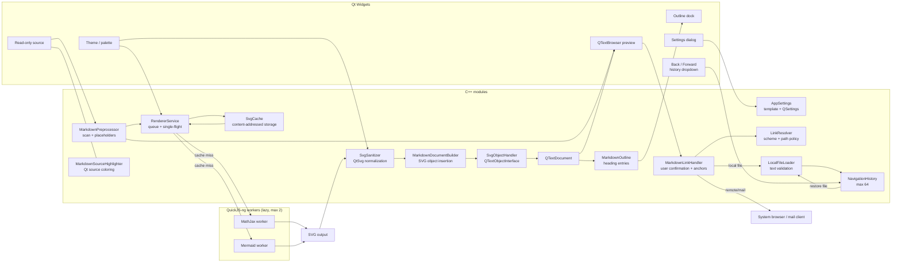

# rich-text-renderer

`rich-text-renderer` 是一个独立的 Qt6 富文本渲染项目，用于验证 locvas 期望的本地 Markdown 富文本渲染能力。本仓库不包含 locvas 的实现或集成。

当前实现覆盖：

- Qt Widgets + `QTextDocument` 渲染 Markdown；
- QuickJS-ng 运行 MathJax，将 TeX 渲染成 SVG；
- QuickJS-ng 运行 Mermaid v13 alpha，将图渲染成 SVG；
- `QSvgRenderer` 通过自定义 `QTextObjectInterface` 直接绘制 SVG；
- 两个懒启动 qjs worker + 内容寻址缓存 + 异步渲染；
- 本地文件链接在窗口内切换，带浏览器式 back/forward 历史；
- 深色 / 浅色主题切换；
- AppImage 打包与体积测量。

> 本项目是独立验证项目，不是生产实现。当前结果证明渲染路线可行，但还未达到可直接发布的产品形态。

## 0. 当前结论

**可行，而且效果已经达到“可以日常试用”的级别。**

- 数学公式：可用；
- Mermaid：可用（基于 alpha 版本）；
- Markdown 表格、中文、emoji、代码块：可用；
- 数学：支持 `$...$`、`\(...\)`、`$$...$$`、`\[...\]`；
- 所有 fenced code 都按代码处理，只有 `mermaid` 例外；`latex`/`math` fence 不渲染成公式；
- 代码高亮：C++ / Python / JS / JSON / Bash / LaTeX；
- 深色模式：可用，公式和 Mermaid 都会随主题重新渲染；
- 缓存：可用，热缓存基本无感；
- renderer service：两个 qjs worker，进程数上限 2；
- Mermaid：full worker，常用图类型 24/24 smoke test 通过；
- 本地链接：非二进制、非目录文件在当前窗口内打开，不再拉起系统编辑器；
- 历史：双向链表记录最多 64 个本地文件，工具栏右侧提供 back/forward 和下拉列表；
- 内存：30 blocks 总 PSS 约 62.2MB，400 blocks 约 72.0MB；
- AppImage：可用，约 **34.3MB / 32.7MiB**，无需 WebEngine；
- 不需要 QtWebEngine，不需要 Node 运行时。

当前最大缺口是**复制/选区**、**安全清洗**和**可见区域优先队列**；代码块语法高亮、本地链接与历史导航已完成。

## 1. 效果评估

### 已经不错的部分

- MathJax SVG 在 `QSvgRenderer` 下渲染清晰，分式、根号、求和、积分、上下标都正常；
- Mermaid v13 alpha 的 DOM-free 渲染在 QuickJS 中确实能跑，流程图、边、边标签、中文都正常；
- 深色模式下数学公式使用系统前景色，不再融入背景；
- Mermaid 深色主题会输出深色节点与浅色文字；
- 30 个 block 冷启动约 250–320ms，热缓存约 13–50ms；
- 400 个 block 冷启动约 1.6s，总 PSS 约 72.0MB；
- Mermaid full bundle：常用图类型 24/24 smoke test 通过；
- 两个 qjs worker 常驻上限，空闲 60s 自动退出；
- AppImage 没有 WebEngine 的体积负担。

### 还不够好的部分

- 没有每条消息复制 / 代码块复制 / 跨消息选区；
- Markdown 只覆盖常用子集，复杂 GFM 未验证；
- Mermaid 仍是 alpha，升级需要回归；
- 缓存是文件缓存，不是 SQLite/Blob；
- SVG sanitizer 是 QtSvg 兼容层，不是完整安全清洗器；
- Mermaid 版本是 alpha，升级需要回归测试。

## 2. 架构



### 渲染链路

````text
Markdown
  → MarkdownPreprocessor 扫描 $$...$$ / ```mermaid
  → 替换成唯一 token，返回 PreparedMarkdown
  → MainWindow 将 prepared Markdown 交给 QTextDocument::setMarkdown()
  → RendererService 检查 / single-flight
  → SvgCache 命中或 worker 输出 SVG
  → SvgSanitizer 归一化
  → MarkdownDocumentBuilder 把 token 替换为自定义对象字符
  → SvgObjectHandler 在绘制时用 QSvgRenderer 直接画 SVG
````

### 缓存

```text
cache key = SHA256(
  renderer version |
  kind (math/mermaid) |
  source |
  display/options |
  theme (mermaid)
)
```

当前缓存目录：

```text
~/.cache/rich-text-renderer/rich-text-renderer/
```

缓存的是**原始 SVG**；颜色/主题在嵌入时由 `SvgSanitizer` 应用。Mermaid 主题不同会生成不同 SVG，因此主题进入 cache key。

## 3. 模块划分

| 模块             | 路径                                  | 职责                                                 |
| ---------------- | ------------------------------------- | ---------------------------------------------------- |
| 应用入口         | `src/main.cpp`                        | 命令行参数、主题覆盖、截图模式                       |
| 主窗口           | `src/MainWindow.*`                    | 标签页、工具栏、目录 dock、主题、设置和异步渲染编排  |
| Markdown 预处理  | `src/MarkdownPreprocessor.*`          | 扫描 math/mermaid、生成 token、保护 code span        |
| 文档构建         | `src/MarkdownDocumentBuilder.*`       | 插入 SVG 对象、token 错误替换、尺寸归一化            |
| 文档目录         | `src/MarkdownOutline.*`               | 从 `QTextDocument` 标题提取层级、标题和 block 编号   |
| Source 高亮      | `src/MarkdownSourceHighlighter.*`     | 只读 Source 的 Markdown 语法着色，不参与渲染         |
| 应用设置         | `src/AppSettings.*`                   | 只读模板默认值、QSettings 用户覆盖、范围校验         |
| 设置对话框       | `src/SettingsDialog.*`                | Appearance / View / Preview / Advanced 设置编辑      |
| 渲染服务         | `src/RendererService.*`               | single-flight、队列、generation 取消                 |
| Worker 进程      | `src/RendererWorker.*`                | 懒启动 qjs、NDJSON、超时、idle、内存/CPU 限制        |
| SVG 缓存         | `src/SvgCache.*`                      | SHA-256 key、文件读写、版本隔离                       |
| 链接解析         | `src/LinkResolver.*`                  | scheme、base URL、本地路径和 canonical path 策略     |
| 链接交互         | `src/MarkdownLinkHandler.*`           | 标题锚点、本地文件请求、远程/邮件确认                |
| 本地文件加载     | `src/LocalFileLoader.*`               | 存在性、目录、大小、二进制检测、UTF-8/UTF-16 解码    |
| 本地历史         | `src/NavigationHistory.*`             | 双向链表、最多 64 条、back/forward、最新优先列表     |
| 代码高亮         | `src/CodeHighlighter.*`               | `BlockCodeLanguage` + `QSyntaxHighlighter`           |
| 目录面板         | `src/OutlinePanel.*`                  | 左侧标题树、层级组织和 block 跳转信号                |
| Preview 点击     | `src/PreviewBrowser.*`                | 识别图片与渲染 SVG 点击，发出预览请求                |
| 媒体预览窗口     | `src/MediaPreviewWindow.*`            | 本地图片与 SVG 预览、缩放、平移和另存                |
| SVG 对象绘制     | `src/SvgObjectHandler.*`              | `QTextObjectInterface` 直接绘制 SVG，不常驻 QImage   |
| SVG 归一化       | `src/SvgSanitizer.*`                  | CSS 变量、颜色、尺寸、深色主题、基础安全清理         |
| 主题             | `src/Theme.*`                         | 浅色/深色 QPalette                                   |
| MathJax 核心     | `renderer/src/mathjax-core.mjs`       | `liteAdaptor` + TeX + SVG                            |
| MathJax worker   | `renderer/src/mathjax-worker.mjs`     | NDJSON worker、常驻渲染 MathJax                       |
| Mermaid worker   | `renderer/src/mermaid-full-worker.mjs` | NDJSON worker；启用完整图集                       |
| 旧 qjs 入口      | `renderer/src/mathjax-qjs.mjs` 等     | 一次性脚本，用于对照测试                             |
| JS 构建          | `renderer/build.mjs`                  | esbuild 打包为 QuickJS 可执行 bundle                 |
| SVG 检查工具     | `tools/svgcheck.cpp`                  | SVG → PNG，验证 QtSvg 兼容性                         |
| 构建脚本         | `scripts/`                            | setup/build/test/bench/package                       |
| 结果文档         | `docs/RESULTS.md`                     | 实测数据、限制、结论                                 |
| 决策记录         | `docs/ADR-0001-rendering-pipeline.md` | 为什么采用这条渲染路线                               |

### 库边界

构建目标按依赖方向拆分：

| CMake 目标 | 内容 | 依赖 |
|---|---|---|
| `rich-text-renderer-core` | Markdown 预处理、应用设置、链接解析、本地文件、历史、SVG 缓存、渲染服务与 worker | `Qt6::Core` |
| `rich-text-renderer-document` | 文档构建、标题目录、Source 高亮、SVG 归一化、SVG 对象、代码高亮 | `Qt6::Gui`、`Qt6::Svg` |
| `rich-text-renderer-ui` | 主窗口、目录面板、设置对话框、链接与媒体交互、主题 | 前两个库、`Qt6::Widgets`、`Qt6::SvgWidgets` |
| `rich-text-renderer` | 应用入口 | `rich-text-renderer-ui` |

依赖方向固定为：

```text
main -> ui -> { core, document }
```

`core` 不依赖 Widgets；`document` 不依赖主窗口。测试按被测模块链接对应库，不再重复编译应用源码。

### 高亮后端与依赖边界

当前代码高亮只使用 Qt 自带的 `QSyntaxHighlighter`：

- 实现：`CodeHighlighter`；
- 支持语言：C++ / Python / JavaScript / JSON / Bash / LaTeX；
- 不引入额外语法高亮库，不改变现有语言集合。

后续如果确实需要更准确的多语言高亮，再评估 KDE Frameworks 6 的 **KSyntaxHighlighting**：

- Fedora 构建依赖：`kf6-syntax-highlighting-devel`；
- Fedora 运行依赖：`kf6-syntax-highlighting`；
- CMake：`find_package(KF6SyntaxHighlighting)`，链接 `KF6::SyntaxHighlighting`；
- 需要适配多语言代码块的状态管理，不能直接用一个单 Definition 实例覆盖整篇文档；
- AppImage 需要打包 `libKF6SyntaxHighlighting.so.6` 及其 Qt6Network 依赖，预计增加约 2–3MB；
- 需要补充许可证说明并重新做主题、语言别名和视觉回归。

当前不启用该后端；这条路线只作为后续维护期的可选替换项记录。

### 配置与设置

完整默认模板位于：

```text
config/settings.ini
```

AppImage 内路径：

```text
usr/share/rich-text-renderer/config/settings.ini
```

模板是只读默认值来源，包含所有用户可配置项和说明注释。用户修改通过 QSettings 写入独立文件，避免 QSettings 重写模板时丢失注释：

```text
QStandardPaths::AppConfigLocation/settings.ini
```

Linux 上通常为：

```text
~/.config/rich-text-renderer/rich-text-renderer/settings.ini
```

配置项：

- `appearance.theme`：light / dark；
- `appearance.uiFontPointSize`：应用与预览字号，8–18；
- `appearance.sourceFontPointSize`：只读 Source 字号，8–24；
- `appearance.sourceHighlighting`：Source Markdown 高亮开关；
- `view.outlineVisible`：左侧目录面板；
- `view.sourceVisible`：Source tab；
- `preview.maxSvgWidth`：预览 SVG 最大宽度；
- `renderer.idleTimeoutMs`、`mathRequestTimeoutMs`、`mermaidRequestTimeoutMs`；
- `files.lastDirectory`、`window.geometry`：运行状态持久化。

Settings 对话框提供 Appearance、View、Preview、Advanced 四组设置，并包含 Restore Defaults。命令行 `--dark` 只覆盖当前进程，不会自动写入用户配置。

## 4. 构建

### 脚本方式

```bash
scripts/setup-quickjs.sh
scripts/setup-renderer.sh
scripts/build.sh
scripts/test.sh
scripts/test-markdown.sh
scripts/test-mermaid-full.py
scripts/test-process-bound.sh
scripts/test-idle.sh
scripts/bench.sh
scripts/mem-bench.sh
```

`scripts/test.sh` 在渲染器 smoke test 之后运行 CTest。当前模块测试包括：

- `link-resolver-test`：scheme、base URL、本地路径和 canonical path；
- `link-handler-test`：本地文件信号、标题锚点和 GitHub slug；
- `main-window-startup-test`：空白启动、空历史、显式加载、目录和设置应用；
- `app-settings-test`：模板默认值、用户覆盖、校验、读写和默认路径；
- `settings-dialog-test`：设置加载、编辑、恢复默认和保留非对话框状态；
- `markdown-preprocessor-test`：数学、Mermaid、fenced code 和货币误判；
- `markdown-outline-test`：标题层级、token 标签、block 顺序和空目录；
- `svg-cache-test`：cache key、display/theme 隔离和内容读写；
- `svg-sanitizer-test`：CSS 变量、颜色、尺寸、脚本和事件属性清理；
- `document-rendering-test`：代码高亮、Source 高亮、fenced code 状态、SVG 插入和错误替换；
- `navigation-history-test`：back/forward、forward 截断和 64 条上限；
- `local-file-loader-test`：文本/二进制/目录/缺失文件/UTF-16/大小限制；
- `media-preview-test`：缩放范围、Fit、1:1、Ctrl+滚轮、栅格与 SVG 另存。

`tests/sources/link-source.md` 可用于手动验证本地文件、锚点、远程链接和危险 scheme。

直接运行全部 CTest：

```bash
cmake --build build -j"$(nproc)"
ctest --test-dir build --output-on-failure
```

### 手动方式

QuickJS-ng：

```bash
git submodule update --init --recursive third_party/quickjs-ng

cmake -S third_party/quickjs-ng -B third_party/quickjs-ng/build \
  -DCMAKE_BUILD_TYPE=Release \
  -DBUILD_SHARED_LIBS=OFF \
  -DQJS_BUILD_LIBC=ON
cmake --build third_party/quickjs-ng/build --target qjs_exe -j"$(nproc)"
```

JS bundles：

```bash
cd renderer
npm install
npm run build
cd ..
```

Qt 应用：

```bash
cmake -S . -B build -DCMAKE_BUILD_TYPE=RelWithDebInfo
cmake --build build -j"$(nproc)"
```

## 5. 使用方法

### GUI

```bash
./build/rich-text-renderer
```

窗口包含：

- 左侧 `Outline` 目录 dock；
- 中央 `Preview` / `Source` 标签页；
- 标签栏最左侧 `Outline` 开关，用于显示或隐藏目录；
- `Source` 为只读视图，支持 Markdown 语法高亮；
- `Load`：使用 Qt 文件对话框打开本地 Markdown 或文本文件，不经过 KDE KIO/KDirModel；
- `Render (Ctrl+Enter)`；
- **`Dark mode` / `Light mode` 切换按钮**；
- `Settings`：编辑字体、视图、预览和渲染器超时；
- 右上角 `Back` / `Forward` 和本地文件历史下拉框。

启动行为：

- 默认不加载任何文档，Preview、Source 和 Outline 均为空，历史也为空；
- 使用 `Load` 或 `--file` 后才打开文件；
- `sample.md` 保留在项目 `samples/` 目录中，但应用代码不硬编码该路径，不会自动加载，也不打包进 AppImage。

加载审计：

- `Load` 和 `--file` 最终都调用同一个 `openLocalFile()`；
- `Load` 使用 Qt 自带文件对话框，不经过 KDE KIO/KDirModel；
- 设置 `RICH_TEXT_RENDER_DEBUG_LOAD=1` 后会输出：
  - 加载来源（command-line / toolbar）；
  - 请求路径；
  - 规范化路径；
  - 文件大小和 mtime；
  - 原始文件 SHA-256；
  - 解码后文本 SHA-256。

示例：

```bash
RICH_TEXT_RENDER_DEBUG_LOAD=1 ./build/rich-text-renderer --file <path>
```

加载新文档后 Preview 会回到顶部并强制刷新视口，避免文件对话框关闭后留下旧绘制区域。

目录行为：

- 从 Qt 生成的 `QTextDocument` 标题层级提取；
- 点击条目切换到 Preview，把目标 block 对齐到视口顶部；
- 标题中的数学/Mermaid token 使用可读替代文字；
- 固定在主窗口左侧，只能隐藏，不能拖动、浮动或取下；
- 标签栏左侧 `Outline` 按钮和 Settings 都可以切换显示状态。

Source 行为：

- 只读，不提供表单式编辑或文件保存；
- Markdown 语法高亮使用 Qt `QSyntaxHighlighter`；
- 可在 Settings 中调整 Source 字号或隐藏 Source tab。

媒体预览：

- 点击 Markdown 内嵌图片，在新的预览窗口打开；
- 点击本地图片链接（包括图片链接语法）打开预览窗口，不替换当前文档；
- 点击已渲染的 MathJax/Mermaid SVG，在新的预览窗口打开；
- 预览窗口支持 Fit、1:1、工具栏按钮和 `Ctrl`+滚轮缩放（5%–800%），可拖拽平移；
- SVG 以当前主题的归一化结果渲染，并保持矢量缩放；
- `Save As` 保存原始栅格图片或 SVG；栅格图片可另存为其他支持格式，SVG 可导出 PNG；
- 远程图片不下载，只提示仅支持本地图片。

链接行为：

- 相对链接以当前 Markdown 文件所在目录为 base；
- `#anchor` 在文档内跳转；没有显式 anchor 的 Markdown 标题按 GitHub 风格 slug 匹配；
- 本机非二进制、非目录文件直接在窗口内加载并重新渲染，不调用系统文本编辑器；
- 本地图片文件走独立预览窗口，不进入文本渲染链路；
- 文本解码支持 UTF-8（含 BOM）、带 BOM 的 UTF-16 LE/BE 和 Latin-1；无 BOM 的 UTF-16 与 UTF-32 会按二进制拒绝；
- 目录、二进制文件、超过 32MiB 的文件会提示并保留当前文档；
- `http/https` 和 `mailto:` 打开前必须确认；
- `javascript:`、`data:` 等 scheme 直接拒绝。

历史行为：

- 使用 `std::list` 双向链表，最多保存 64 条；
- 新导航发生在历史中间时，forward 历史被丢弃；再次导航到当前文件也会丢弃 forward；
- `Back` / `Forward` 按浏览器语义移动；
- 下拉列表最新记录在上、最远记录在下；
- 列表只显示文件名，tooltip 显示完整路径；
- 选中历史项会直接切换文件，不新增重复记录。

> 本地历史目前只保存文件路径，不保存滚动位置或锚点。
> Source 是只读视图，不提供编辑保存能力，因此导航切换不会产生未保存文档内容。

切换主题会重新渲染当前文档，MathJax 使用新的前景色，Mermaid 使用新的主题。

浅色模式使用显式的 `#ffffff` 背景和 `#111111` 文字，不依赖系统标准调色板；深色模式使用显式的 `#1e1e1e` 背景和 `#e6e6e6` 文字。

### 命令行

```bash
# 渲染指定 Markdown
./build/rich-text-renderer --file tests/sources/bench.md

# 以深色模式启动
./build/rich-text-renderer --dark

# 启动 1.5 秒后自动切换一次主题（用于截图/测试）
./build/rich-text-renderer --file samples/sample.md --toggle-theme --screenshot out/toggle.png

# 无头截图（8 秒后保存）
QT_QPA_PLATFORM=offscreen ./build/rich-text-renderer --file samples/sample.md --screenshot out/app.png

# 深色截图
QT_QPA_PLATFORM=offscreen ./build/rich-text-renderer --file samples/sample.md --dark --screenshot out/app-dark.png
```

### 测试与基准

```bash
scripts/test.sh
scripts/test-markdown.sh
scripts/test-mermaid-full.py
scripts/test-process-bound.sh
scripts/test-idle.sh
scripts/bench.sh
scripts/mem-bench.sh tests/sources/bench400.md bench400
```

`mem-bench.sh` 会采样主进程与 qjs 进程的 PSS，并检查：

- qjs worker 数 ≤2；
- 总应用 PSS ≤128MB。

`test-idle.sh` 使用 `RICH_TEXT_RENDER_IDLE_MS=2000` 验证 worker 空闲退出。

`test-markdown.sh` 验证数学分隔符/代码块 token 数量；`test-mermaid-full.py` 验证完整 Mermaid worker 的常用图类型。

## 6. 打包与发布流水线

### 当前脚本

```bash
scripts/package-appimage.sh
```

脚本流程：

1. 用 `linuxdeploy --plugin qt` 把 Qt 依赖/插件部署到 `AppDir`；
2. 复制 `qjs` 到 `AppDir/usr/bin/qjs`；
3. 只复制运行时使用的 `mathjax-worker.mjs` 和 `mermaid-full-worker.mjs` 到 `AppDir/usr/share/rich-text-renderer/renderer/dist/`；
4. 复制 `config/settings.ini` 到 `AppDir/usr/share/rich-text-renderer/config/`；
5. 写入 `AppRun`、desktop、icon；
6. 用 `appimagetool` 生成 `dist/rich-text-renderer-x86_64.AppImage`。

脚本默认从 `PATH` 查找：

- `linuxdeploy`：从 <https://github.com/linuxdeploy/linuxdeploy/releases> 获取 AppImage；
- `appimagetool`：从 <https://github.com/AppImage/appimagetool/releases> 获取 AppImage。

下载后赋予可执行权限并放入 `PATH`，或者直接指定程序路径：

```bash
LINUXDEPLOY=/path/to/linuxdeploy \
APPIMAGETOOL=/path/to/appimagetool \
scripts/package-appimage.sh
```

脚本使用 AppImage 的 `--appimage-extract-and-run` 参数，因此不需要系统安装 FUSE。

### 当前产物

```text
dist/rich-text-renderer-x86_64.AppImage
```

> 当前 `dist/` 已包含 renderer service 和 worker 脚本；改动代码后需重新执行
> `scripts/package-appimage.sh`。

验证：

```bash
QT_QPA_PLATFORM=offscreen ./dist/rich-text-renderer-x86_64.AppImage \
  --appimage-extract-and-run --file samples/sample.md --dark \
  --screenshot out/appimage-dark.png
```

### 体积

| 项                         |       大小 |
| -------------------------- | ---------: |
| qjs                        |      1.5MB |
| MathJax worker bundle      |      1.8MB |
| Mermaid full worker bundle |      2.1MB |
| AppImage                   | **34.3MB / 32.7MiB** |
| AppDir（未压缩）           |      约 85MB |
| 运行时渲染链（qjs + 两个 worker） | 约 5.4MB |

### CI 建议

正式发布前建议：

1. 固定 Qt、QuickJS、Node、linuxdeploy、appimagetool 版本；
2. 在干净的 Fedora/Ubuntu 虚拟机跑 AppImage smoke test；
3. 用真实 AI 输出语料做 Markdown/MathJax/Mermaid 回归；
4. 校验 AppImage 内 `qjs`、JS bundles 和 `config/settings.ini` 的路径；
5. 把 `scripts/package-appimage.sh` 拆成 CI job，产物上传到 release；
6. 处理 `linuxdeploy` 在 Fedora `.relr.dyn` 上的 strip 报错（固定打包基础镜像或关闭 strip）。

## 7. 当前限制

### 渲染

- Qt Markdown 只覆盖常用子集；复杂嵌套列表、脚注、部分 GFM 未验证；
- 数学分隔符支持 `\(...\)`、`$...$`、`$$...$$`、`\[...\]`；
- 代码块已支持 C++/Python/JS/JSON/Bash/LaTeX 高亮；
- 当前高亮器是项目内 `CodeHighlighter`（正则近似），不包含 KSyntaxHighlighting；替换依赖和迁移条件见“高亮后端与依赖边界”；
- Source 高亮也是 Qt `QSyntaxHighlighter` 的轻量规则，不是完整 Markdown parser；
- 目录尚未根据滚动位置高亮当前节；
- 代码块背景、边框、行距仍可继续打磨；
- Mermaid 不是生产版本，固定为 `13.0.0-alpha.3`；
- Mermaid full worker 已启用；常用图 24/24 smoke test 通过，但 alpha 版本的全部 33 种图仍需完整回归；
- Mermaid SVG 需要 `SvgSanitizer` 做 QtSvg 兼容处理；
- `QSvgRenderer` 不是完整浏览器 SVG，复杂滤镜/字体特性未验证；
- 未做高 DPI、字体回退、RTL 的全量测试。

### 交互

- Source 只读，没有编辑、保存或外部修改同步；
- 图片/SVG 预览支持缩放和平移，不提供旋转；远程图片不下载；
- 没有每条消息复制；
- 没有代码块复制；
- 没有跨消息任意拖选；
- 没有流式 token 增量渲染（当前是文档级重渲染）；
- 取消/队列已实现，但可见区域优先尚未实现；
- 本地历史只记录文件路径，不记录滚动位置或锚点；
- 本地文件加载没有 workspace allowlist。

### 进程与性能

- 已改为两个懒启动 qjs worker（MathJax / Mermaid），进程数上限 2；
- 30 blocks：总 PSS 约 62.2MB，冷启动约 250–320ms；
- 400 blocks：总 PSS 约 72.0MB，冷启动约 1.5–1.7s；
- 空闲 60s 自动退出（测试可缩短到 2s）；
- worker 有内存/CPU rlimit、请求超时、崩溃重启；
- 当前是 FIFO 队列，可见区域优先尚未实现。

> 早期预留的 qjs 进程组 PSS 子目标（slim 40MB / full 50MB）已不再作为硬性验收口径。
> full Mermaid 当前约 41–46MB，总应用约 62–72MB，满足使用需求。
> 后续只为“总应用 PSS ≤128MB”负责，不再为压低 qjs 单项数字牺牲完整图集。

### 缓存与数据

- 缓存是文件缓存，不是 SQLite/Blob；
- cache key 已包含渲染器版本、kind、source、options、Mermaid 主题；
- 未包含 DPI/字体/主题色（MathJax 的颜色在嵌入时处理，但未来加主题色时需要扩展）；
- 没有缓存清理/容量控制。

### 配置

- 模板是只读默认值，实际用户修改写入独立的 QSettings 文件；
- QSettings 保存用户文件时不会保留手工写在用户文件中的注释；
- 窗口几何、最近目录和可见性会持久化，但不会持久化打开过的文档内容；
- Settings 对话框暂不直接编辑模板文件路径或 `window.geometry` 原始值。

### 安全

- `SvgSanitizer` 只做 QtSvg 兼容和基础清理，不是完整安全清洗器；
- 没有对 MathJax/Mermaid 输入做严格的资源/复杂度限制；
- qjs 运行受信任的 bundle；未来若允许第三方 JS，需要沙箱；
- 没有对 SVG 外部资源、脚本、事件属性做完整白名单；
- 本地链接可在窗口内读取任意非二进制文件（单文件上限 32MiB），尚未做 workspace allowlist；
- 文本/二进制判断基于 NUL、MIME 和 UTF-8 有效性，是启发式检查，不是内容审计；
- 没有安全审计。

### 打包

- AppImage 只在当前 Fedora 环境验证；
- `linuxdeploy` strip 在 Fedora `.relr.dyn` 上会报错，但 AppDir 仍可打包；
- 没有在干净虚拟机/不同发行版验证；
- 没有 Windows/macOS；
- Qt LGPL 合规材料尚未系统化。

## 8. 下一步

完整待办与建议打磨顺序见 [TODO.md](TODO.md) 的 **Polish 顺序** 小节。

1. **每条消息复制 + 代码块复制**：实际使用差距最大；
2. **renderer service 收尾**：可见区域优先、崩溃恢复测试；
3. **SVG sanitizer hardening**：脚本/事件/外链白名单；
4. **SQLite/Blob 缓存**；
5. **真实 AI 输出语料 + golden 测试**；
6. **AppImage CI** 与干净环境验证；
7. 再评估是否需要跨消息选区。

## 9. 目录

```text
src/                    Qt Widgets 应用与渲染/缓存逻辑
renderer/               MathJax/Mermaid 的 QuickJS bundle
third_party/quickjs-ng  QuickJS-ng submodule
config/                 完整 settings.ini 默认模板
samples/                demo Markdown（sample.md）
tests/sources/          测试输入：公式 / Mermaid / 基准 Markdown
tools/svgcheck.cpp      SVG -> PNG 的 QtSvg 检查工具
docs/                   验证结果、流程与 ADR
docs/assets/            最终截图
packaging/              desktop/icon
scripts/                构建、测试、基准、打包
dist/                   生成的 AppImage（gitignored）
```

## 10. 第三方与许可证

见 [THIRD_PARTY_NOTICES.md](THIRD_PARTY_NOTICES.md)。

主要依赖：

- Qt 6 — LGPLv3 / commercial；
- QuickJS-ng — MIT；
- MathJax 3.2.2 — Apache-2.0；
- Mermaid 13.0.0-alpha.3 — MIT；
- esbuild — MIT（仅构建时）。
