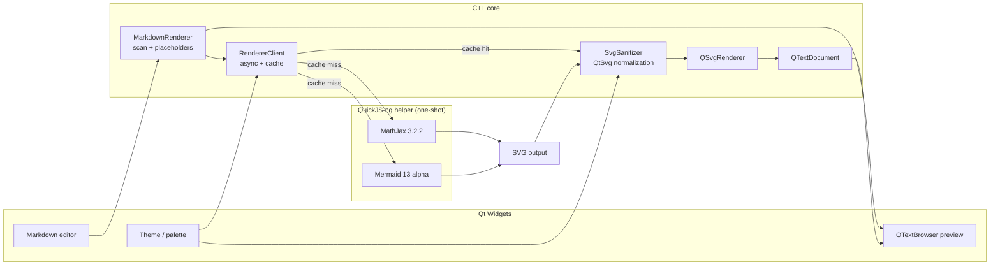

# rich-text-render spike

一个独立的 Qt6 富文本渲染 spike，用来验证：

- Qt Widgets + `QTextDocument` 渲染 Markdown；
- QuickJS-ng 运行 MathJax，将 TeX 渲染成 SVG；
- QuickJS-ng 运行 Mermaid v13 alpha，将图渲染成 SVG；
- `QSvgRenderer` 把 SVG 栅格化后嵌入 `QTextDocument`；
- 内容寻址缓存 + 异步渲染；
- 深色 / 浅色主题切换；
- AppImage 打包与体积测量。

> 这是验证项目，不是生产实现。它证明路线可行，但还没有达到可直接发布的产品形态。

## 0. 当前结论

**可行，而且效果已经达到“可以日常试用”的级别。**

- 数学公式：可用；
- Mermaid：可用（基于 alpha 版本）；
- Markdown 表格、中文、emoji、代码块：可用；
- 深色模式：可用，公式和 Mermaid 都会随主题重新渲染；
- 缓存：可用，热缓存基本无感；
- AppImage：可用，约 73–76MB，渲染链只增加约 2–3MB；
- 不需要 QtWebEngine，不需要 Node 运行时。

当前最大缺口是**代码块语法高亮**、**复制/选区**、**renderer service** 和**安全清洗**。

## 1. 效果评估

### 已经不错的部分

- MathJax SVG 在 `QSvgRenderer` 下渲染清晰，分式、根号、求和、积分、上下标都正常；
- Mermaid v13 alpha 的 DOM-free 渲染在 QuickJS 中确实能跑，流程图、边、边标签、中文都正常；
- 深色模式下数学公式使用系统前景色，不再融入背景；
- Mermaid 深色主题会输出深色节点与浅色文字；
- 30 个 block 冷启动约 400–430ms，热缓存约 30–50ms；
- AppImage 没有 WebEngine 的体积负担。

### 还不够好的部分

- 代码块只是等宽文本，没有语法高亮；
- 没有每条消息复制 / 代码块复制 / 跨消息选区；
- 每个 block 一个一次性 `qjs` 进程，批量时会形成进程峰值；
- Markdown 只覆盖常用子集，复杂 GFM 未验证；
- 缓存是文件缓存，不是 SQLite/Blob；
- SVG sanitizer 是 QtSvg 兼容层，不是完整安全清洗器；
- Mermaid 版本是 alpha，升级需要回归测试。

## 2. 架构



### 渲染链路

```text
Markdown
  → 扫描 $$...$$ / ```mermaid
  → 替换成唯一 token
  → QTextDocument::setMarkdown()
  → 每个 token 异步调用 qjs
      → MathJax 或 Mermaid 输出 SVG
      → 写入内容寻址缓存
  → SvgSanitizer 归一化
  → QSvgRenderer 栅格化为 QImage
  → QTextDocument::addResource + QTextImageFormat
  → token 被替换成图片
```

### 缓存

```text
cache key = SHA256(
  renderer version |
  kind (math/mermaid) |
  source |
  display/options |
  theme (mermaid)
)
```

当前缓存目录：

```text
~/.cache/locvas-spike/rich-text-render-spike/rich-text-render-spike/
```

缓存的是**原始 SVG**；颜色/主题在嵌入时由 `SvgSanitizer` 应用。Mermaid 主题不同会生成不同 SVG，因此主题进入 cache key。

## 3. 模块划分

| 模块 | 路径 | 职责 |
|---|---|---|
| 应用入口 | `src/main.cpp` | 命令行参数、主题初始值、截图模式 |
| 主窗口 | `src/MainWindow.*` | 编辑器/预览 splitter、工具栏、主题切换、异步渲染编排 |
| Markdown 处理 | `src/MarkdownRenderer.*` | 扫描 math/mermaid、生成 token、嵌入 SVG 图像 |
| 渲染客户端 | `src/RendererClient.*` | 启动 qjs、缓存命中/写入、超时与错误处理 |
| SVG 归一化 | `src/SvgSanitizer.*` | CSS 变量、颜色、尺寸、深色主题、基础安全清理 |
| 主题 | `src/Theme.*` | 浅色/深色 QPalette |
| MathJax 核心 | `renderer/src/mathjax-core.mjs` | `liteAdaptor` + TeX + SVG |
| MathJax qjs 入口 | `renderer/src/mathjax-qjs.mjs` | stdin/文件输入、SVG 输出 |
| Mermaid qjs 入口 | `renderer/src/mermaid-qjs.mjs` | `mermaid/slim` + flowchart/sequence/state |
| JS 构建 | `renderer/build.mjs` | esbuild 打包为 QuickJS 可执行 bundle |
| SVG 检查工具 | `tools/svgcheck.cpp` | SVG → PNG，验证 QtSvg 兼容性 |
| 构建脚本 | `scripts/` | setup/build/test/bench/package |
| 结果文档 | `docs/RESULTS.md` | 实测数据、限制、结论 |
| 决策记录 | `docs/ADR-0001-rendering-pipeline.md` | 为什么采用这条渲染路线 |

## 4. 构建

### 脚本方式

```bash
scripts/setup-quickjs.sh
scripts/setup-renderer.sh
scripts/build.sh
scripts/test.sh
scripts/bench.sh
```

### 手动方式

QuickJS-ng：

```bash
cmake -S third_party/quickjs-ng -B third_party/quickjs-ng/build \
  -DCMAKE_BUILD_TYPE=Release \
  -DBUILD_SHARED_LIBS=OFF \
  -DQJS_BUILD_LIBC=ON
cmake --build third_party/quickjs-ng/build --target qjs_exe -j"$(nproc)"
```

JS bundles：

```bash
cd renderer
npm install
npm run build
cd ..
```

Qt 应用：

```bash
cmake -S . -B build -DCMAKE_BUILD_TYPE=RelWithDebInfo
cmake --build build -j"$(nproc)"
```

## 5. 使用方法

### GUI

```bash
./build/rich-text-render
```

窗口包含：

- 左侧 Markdown 编辑器；
- 右侧渲染预览；
- `Load sample`；
- `Render (Ctrl+Enter)`；
- **`Dark mode` / `Light mode` 切换按钮**。

切换主题会重新渲染当前文档，MathJax 使用新的前景色，Mermaid 使用新的主题。

浅色模式使用显式的 `#ffffff` 背景和 `#111111` 文字，不依赖系统标准调色板；深色模式使用显式的 `#1e1e1e` 背景和 `#e6e6e6` 文字。

### 命令行

```bash
# 渲染指定 Markdown
./build/rich-text-render --file samples/bench.md

# 以深色模式启动
./build/rich-text-render --dark

# 启动 1.5 秒后自动切换一次主题（用于截图/测试）
./build/rich-text-render --toggle-theme --screenshot out/toggle.png

# 无头截图（8 秒后保存）
QT_QPA_PLATFORM=offscreen ./build/rich-text-render --screenshot out/app.png

# 深色截图
QT_QPA_PLATFORM=offscreen ./build/rich-text-render --dark --screenshot out/app-dark.png
```

### 测试与基准

```bash
scripts/test.sh
scripts/test-process-bound.sh
scripts/bench.sh
```

`bench.sh` 会清空缓存，跑一次冷缓存和一次热缓存，输出 SUMMARY。

## 6. 打包与发布流水线

### 当前脚本

```bash
scripts/package-appimage.sh
```

脚本流程：

1. 用 `linuxdeploy --plugin qt` 把 Qt 依赖/插件部署到 `AppDir`；
2. 复制 `qjs` 到 `AppDir/usr/bin/qjs`；
3. 复制 `renderer/dist/*.mjs` 到 `AppDir/usr/share/rich-text-render/renderer/dist/`；
4. 复制 sample；
5. 写入 `AppRun`、desktop、icon；
6. 用 `appimagetool` 生成 `dist/rich-text-render-x86_64.AppImage`。

脚本默认使用：

```text
/tmp/opencode/linuxdeploy-x86_64.AppImage
/tmp/opencode/appimagetool-x86_64.AppImage
```

也可以通过环境变量覆盖：

```bash
LINUXDEPLOY=/path/to/linuxdeploy \
APPIMAGETOOL=/path/to/appimagetool \
scripts/package-appimage.sh
```

### 当前产物

```text
dist/rich-text-render-x86_64.AppImage
```

验证：

```bash
QT_QPA_PLATFORM=offscreen ./dist/rich-text-render-x86_64.AppImage \
  --appimage-extract-and-run --dark --screenshot out/appimage-dark.png
```

### 体积

| 项 | 大小 |
|---|---:|
| qjs | 1.5MB |
| MathJax bundle | 1.8MB |
| Mermaid bundle | 664KB |
| AppImage | 约 73–76MB |
| 去掉渲染链的 base AppImage | 73.1MB |
| 渲染链增量 | 约 2–3MB |

### CI 建议

正式发布前建议：

1. 固定 Qt、QuickJS、Node、linuxdeploy、appimagetool 版本；
2. 在干净的 Fedora/Ubuntu 虚拟机跑 AppImage smoke test；
3. 用真实 AI 输出语料做 Markdown/MathJax/Mermaid 回归；
4. 校验 AppImage 内 `qjs`、JS bundles、sample 的路径；
5. 把 `scripts/package-appimage.sh` 拆成 CI job，产物上传到 release；
6. 处理 `linuxdeploy` 在 Fedora `.relr.dyn` 上的 strip 报错（固定打包基础镜像或关闭 strip）。

## 7. 当前限制

### 渲染

- Qt Markdown 只覆盖常用子集；复杂嵌套列表、脚注、部分 GFM 未验证；
- 只支持 `\(...\)` 行内数学和 `$$...$$` 块级数学；
- 不支持 `\[...\]`、`$...$`；
- 代码块没有语法高亮；
- 代码块/表格的视觉样式比较基础；
- Mermaid 不是生产版本，固定为 `13.0.0-alpha.3`；
- Mermaid 只打包了 flowchart/sequence/state，其他图类型未启用；
- Mermaid SVG 需要 `SvgSanitizer` 做 QtSvg 兼容处理；
- `QSvgRenderer` 不是完整浏览器 SVG，复杂滤镜/字体特性未验证；
- 未做高 DPI、字体回退、RTL 的全量测试。

### 交互

- 没有每条消息复制；
- 没有代码块复制；
- 没有跨消息任意拖选；
- 没有流式 token 增量渲染（当前是文档级重渲染）；
- 没有取消正在进行的渲染请求；
- 没有渲染队列/并发限制。

### 进程与性能

- 每个 block 启动一个一次性 `qjs` 进程；
- 30 blocks 会形成 30 个进程峰值；实测 qjs PSS 约 285–290MB；
- 文件/主题切换时的旧进程已能取消，但并发仍无上限（renderer service 待做）；
- 冷启动 30 blocks 约 400–430ms，热缓存约 30–50ms；
- 生产版应改成懒启动 renderer service/pool，空闲退出；
- 没有内存上限/子进程隔离策略的正式实现。

### 缓存与数据

- 缓存是文件缓存，不是 SQLite/Blob；
- cache key 已包含渲染器版本、kind、source、options、Mermaid 主题；
- 未包含 DPI/字体/主题色（MathJax 的颜色在嵌入时处理，但未来加主题色时需要扩展）；
- 没有缓存清理/容量控制。

### 安全

- `SvgSanitizer` 只做 QtSvg 兼容和基础清理，不是完整安全清洗器；
- 没有对 MathJax/Mermaid 输入做严格的资源/复杂度限制；
- qjs 运行受信任的 bundle；未来若允许第三方 JS，需要沙箱；
- 没有对 SVG 外部资源、脚本、事件属性做完整白名单；
- 没有安全审计。

### 打包

- AppImage 只在当前 Fedora 环境验证；
- `linuxdeploy` strip 在 Fedora `.relr.dyn` 上会报错，但 AppDir 仍可打包；
- 没有在干净虚拟机/不同发行版验证；
- 没有 Windows/macOS；
- Qt LGPL 合规材料尚未系统化。

## 8. 下一步

完整待办与建议打磨顺序见 [TODO.md](TODO.md) 的 **Polish 顺序** 小节。

1. **代码块语法高亮**：优先做，视觉差距最大；
2. **每条消息复制 + 代码块复制**；
3. **renderer service**：懒启动、复用、空闲退出，替代 one-shot qjs；
4. **SVG sanitizer  hardening**：脚本/事件/外链白名单；
5. **SQLite/Blob 缓存**；
6. **真实 AI 输出语料 + golden 测试**；
7. **AppImage CI** 与干净环境验证；
8. 再评估是否需要跨消息选区。

## 9. 目录

```text
src/                    Qt Widgets 应用与渲染/缓存逻辑
renderer/               MathJax/Mermaid 的 QuickJS bundle
third_party/quickjs-ng  QuickJS-ng 源码与构建
samples/                测试 Markdown / TeX / Mermaid
tools/svgcheck.cpp      SVG -> PNG 的 QtSvg 检查工具
docs/                   spike 结果与 ADR
packaging/              desktop/icon
scripts/                构建、测试、基准、打包
dist/                   生成的 AppImage
```

## 10. 第三方与许可证

见 [THIRD_PARTY_NOTICES.md](THIRD_PARTY_NOTICES.md)。

主要依赖：

- Qt 6 — LGPLv3 / commercial；
- QuickJS-ng — MIT；
- MathJax 3.2.2 — Apache-2.0；
- Mermaid 13.0.0-alpha.3 — MIT；
- esbuild — MIT（仅构建时）。
