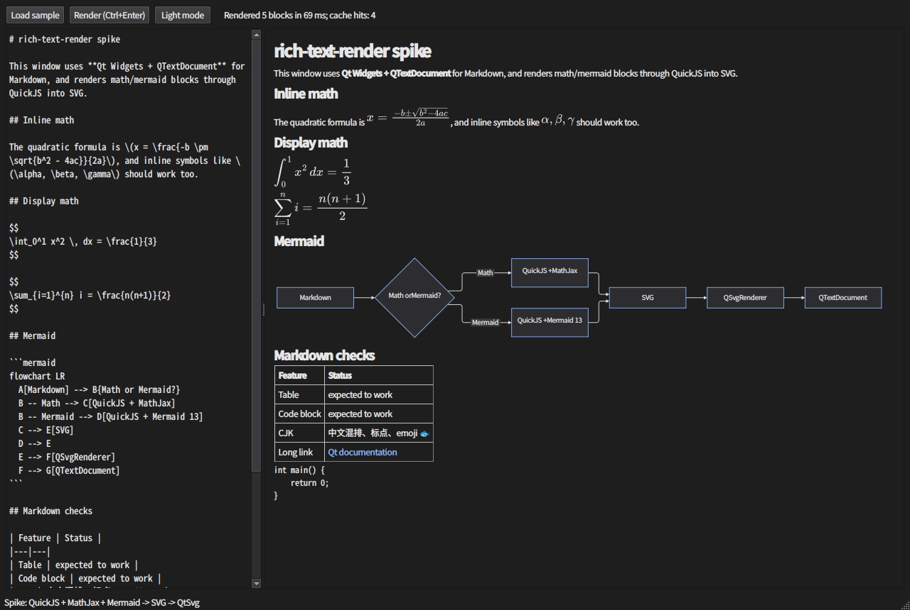
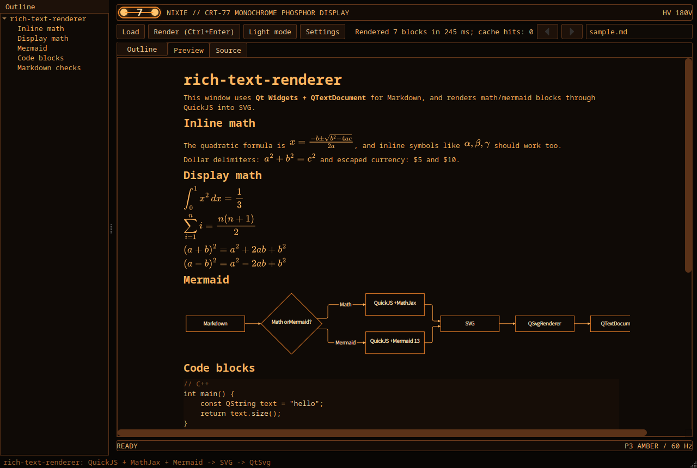

# rich-text-renderer

面向本地 Markdown 文件的 Qt6 桌面阅读器。应用使用 `QTextDocument` 排版文档，通过 QuickJS-ng worker 运行 MathJax 与 Mermaid，将公式和图表渲染为 SVG 后嵌入预览；运行时不依赖 QtWebEngine，也不需要 Node.js。

本仓库同时是 locvas 本地 Markdown 富文本渲染能力的参考实现。locvas 相关的行为契约、资源约束和验收条件见 [FOR_LOCVAS.md](FOR_LOCVAS.md)。



## 功能

- 常用 Markdown 子集：标题、段落、强调、链接、图片、表格、行内代码和围栏代码。
- 行内与块级 TeX：支持 `$...$`、`\(...\)`、`$$...$$`、`\[...\]`。
- Mermaid 图表：通过全量 Mermaid worker 渲染，固定版本 `13.0.0-alpha.3`。
- 代码高亮：C++、Python、JavaScript、JSON、Bash、LaTeX，基于 Qt `QSyntaxHighlighter`。
- 本地文件导航：相对链接、标题锚点、窗口内文件切换和最多 64 条浏览器式历史。
- 目录面板：从文档标题生成，点击条目把目标位置对齐到 Preview 顶部。
- 只读 Source 视图：提供 Markdown 语法高亮，不提供编辑和保存。
- 媒体预览：图片和渲染后的 SVG 支持缩放、平移、Fit、1:1 和另存。
- 浅色/深色主题、可配置字体、视图状态和渲染器超时。
- 内容寻址 SVG 缓存，以及 MathJax / Mermaid 两个懒启动 qjs worker。
- AppImage 打包，不包含 WebEngine 或测试用一次性渲染脚本。

## 环境要求

| 依赖 | 要求 |
|---|---|
| 操作系统 | Linux x86_64；当前在 Fedora 上验证 |
| Qt | 6.8 或更高，需 Widgets、Svg、SvgWidgets、UiTools |
| CMake | 3.21 或更高 |
| 编译器 | 支持 C++20 |
| QuickJS-ng | `third_party/quickjs-ng` 子模块，以静态库构建 |
| Node.js / npm | 仅构建 renderer bundle 时需要 |
| linuxdeploy / appimagetool | 可选，仅生成 AppImage 时需要 |

开发环境使用 Qt 6.11.2、CMake 4.3.0、GCC 16.2.1、QuickJS-ng 0.18.0 和 Node.js 22。Fedora 上需要安装 `qt6-qttools-devel` 以提供 `Qt6::UiTools`。

## 构建

### 脚本方式

```bash
git submodule update --init --recursive third_party/quickjs-ng

scripts/setup-quickjs.sh
scripts/setup-renderer.sh
scripts/build.sh
```

`scripts/build.sh` 默认使用 `RelWithDebInfo`。发布 AppImage 前必须显式构建 Release：

```bash
BUILD_TYPE=Release scripts/build.sh
```

### 手动方式

构建 QuickJS-ng：

```bash
git submodule update --init --recursive third_party/quickjs-ng

cmake -S third_party/quickjs-ng -B third_party/quickjs-ng/build \
  -DCMAKE_BUILD_TYPE=Release \
  -DBUILD_SHARED_LIBS=OFF \
  -DQJS_BUILD_LIBC=ON
cmake --build third_party/quickjs-ng/build --target qjs_exe -j"$(nproc)"
```

构建 MathJax / Mermaid bundle：

```bash
cd renderer
npm ci
npm run build
cd ..
```

构建 Qt 应用：

```bash
cmake -S . -B build -DCMAKE_BUILD_TYPE=RelWithDebInfo
cmake --build build -j"$(nproc)"
```

产物为 `build/rich-text-renderer`。

## 运行

```bash
./build/rich-text-renderer
```

应用默认不加载文档。使用工具栏的 `Load` 选择本地 Markdown 或文本文件，或通过命令行指定文件：

```bash
./build/rich-text-renderer --file samples/sample.md
```

### 命令行参数

| 参数 | 说明 |
|---|---|
| `--file <path>` | 启动时加载指定本地文件 |
| `--dark` | 以深色主题启动，仅覆盖当前进程 |
| `--toggle-theme` | 启动 1.5 秒后切换一次主题，主要用于截图测试 |
| `--screenshot <path>` | 启动 8 秒后保存窗口截图 |

### 调试输出

| 环境变量 | 作用 |
|---|---|
| `RICH_TEXT_RENDER_DEBUG_LOAD=1` | 输出路径、大小和 mtime 审计信息 |
| `RICH_TEXT_RENDER_DEBUG=1` | 输出渲染摘要和缓存命中信息 |
| `RICH_TEXT_RENDER_IDLE_MS=<ms>` | 覆盖 worker 空闲退出时间 |

## 配置

默认模板位于 `config/settings.ini`，包含全部可配置项和说明注释。用户修改通过 QSettings 写入独立文件：

```text
QStandardPaths::AppConfigLocation/settings.ini
```

Linux 上通常为：

```text
~/.config/rich-text-renderer/rich-text-renderer/settings.ini
```

Settings 对话框提供 Appearance、View、Preview、Advanced 四组设置，并支持 Restore Defaults。主要配置项包括：

- 主题、命名布局 variant、应用/预览字号、Source 字号和 Source 高亮；
- Outline 与 Source 可见性；
- 预览 SVG 最大宽度；
- MathJax / Mermaid 请求超时与 worker 空闲超时；
- 最近目录和窗口几何。

### 主题配置

内置主题为 `light` 和 `dark`，保持当前 QPalette 视觉，不额外应用 QSS。

用户主题位于：

```text
QStandardPaths::AppDataLocation/themes/<theme-id>/theme.json
```

Linux 上通常为：

```text
~/.local/share/rich-text-renderer/rich-text-renderer/themes/<theme-id>/theme.json
```

主题 JSON 支持颜色、字体族、尺寸、语法高亮色板、Preview 外观、Mermaid 主题、PNG/JPEG 资源、插槽样式、QSS 开关和可选的静态 `.ui` 布局声明，不接受任意 QSS 或代码。用户主题默认启用 QSS；内置主题和显式设置 `"qss": false` 的主题只使用 QPalette。

所有字号仍由 Settings 控制。主题不提供字号字段，`.ui` 中的 `font/pointsize` 会被拒绝；主题只能提供字体族。

示例主题见 `samples/themes/` 目录，目前包含 `warm-dark`、`aurora-dark` 和 `nixie-crt`。复制到用户主题目录后，在 Settings 的 Appearance 页选择；Settings 中的 `Open themes folder` 会打开主题目录。`aurora-dark` 同时包含可选 `.ui` 中央布局、插槽样式和自定义文档边距。

`nixie-crt` 是完整的暖橙色单色 CRT / 辉光管示例包，包含 PNG 标志、Preview 居中阅读列、Mermaid 颜色变量、具名插槽样式，以及 `console`（tabs）和 `dual`（slots）两种手动布局。安装方法、配色和使用的配置能力见 `samples/themes/nixie-crt/README.md`。



#### 主题排版

```json
{
  "typography": {
    "uiFontFamily": "Noto Sans",
    "previewFontFamily": "Noto Serif",
    "codeFontFamily": "JetBrains Mono"
  },
  "metrics": {
    "spacing": 8,
    "documentMargin": 16
  }
}
```

- `typography.uiFontFamily` 设置应用字体族；
- `typography.previewFontFamily` 只影响 Preview 文档；
- `typography.codeFontFamily` 影响 Source 视图和 Preview 代码块字体族；
- `metrics.spacing` 是 C++ 默认中央布局的间距默认值，`.ui` 显式设置的间距优先；
- `metrics.documentMargin` 设置 Preview 文档边距，默认 12。

字体不存在时回退到应用默认字体。主题包不能携带字体文件，也不能覆盖字号。

#### 语法高亮色板

```json
{
  "syntax": {
    "code": {
      "keyword": "#cf8e6d",
      "string": "#6aab73",
      "number": "#2aacb8",
      "comment": "#7a7a7a",
      "preprocessor": "#b5a642",
      "type": "#56a8f5",
      "function": "#56a8f5"
    },
    "source": {
      "heading": "#8ab4f8",
      "bold": "#e6e6e6",
      "emphasis": "#e6e6e6",
      "inlineCode": "#d7ba7d",
      "link": "#8ab4f8",
      "quote": "#9a9a9a",
      "marker": "#c586c0",
      "fence": "#6aab73",
      "math": "#b5a642"
    }
  }
}
```

缺失的键使用当前浅色/深色默认色板；非法颜色会导致主题加载失败并回退。主题切换时语法色板只重新应用高亮格式，不改变 MathJax/Mermaid 的缓存 key。

#### 具名插槽样式

```json
{
  "slots": {
    "top": {
      "background": "#202124",
      "borderColor": "#3c4043",
      "borderWidth": 1,
      "radius": 8,
      "padding": 8
    },
    "content": {
      "borderColor": "#30363d",
      "borderWidth": 1
    }
  }
}
```

支持的插槽键：

- `top`
- `bottom`
- `empty`
- `toolbarLeading`
- `toolbarTrailing`
- `content`
- `preview`（`contentMode: slots`）
- `source`（`contentMode: slots`）
- `outline`（`contentMode: slots`）

支持的字段只有 `background`、`borderColor`、`borderWidth`（0–8）、`radius`（0–32）和 `padding`（0–32）。插槽样式只在 `qss` 启用时生效；`qss: false` 的主题不会应用 `slots` 规则。主题不能提供任意 QSS；应用会把固定属性选择器追加到内置模板：

```css
QWidget[centralSlot="top"] { ... }
```

插槽宿主暴露动态属性 `centralSlot`，用于稳定匹配。没有 `slots` 字段时不会生成额外规则。

#### Preview 外观

```json
{
  "preview": {
    "maxTextWidth": 0,
    "codeBackground": "#161b22",
    "codeBlockMargin": 8
  }
}
```

- `maxTextWidth`：默认 `0`，沿用当前 viewport 宽度；正整数时启用居中阅读列；
- `codeBackground`：代码块背景色；
- `codeBlockMargin`：代码块首尾的上下间距；
- `documentMargin` 仍由 `metrics.documentMargin` 控制；
- 字号仍由 Settings 控制。

#### Mermaid 主题

```json
{
  "mermaid": {
    "theme": "base",
    "variables": {
      "primaryColor": "#2dd4bf",
      "lineColor": "#8b949e",
      "textColor": "#e6edf3"
    }
  }
}
```

内置主题枚举支持 `default`、`dark`、`forest`、`neutral`、`base`。变量只允许颜色键：

- `primaryColor`
- `lineColor`
- `textColor`
- `mainBkg`
- `nodeBorder`
- `nodeTextColor`
- `arrowheadColor`
- `edgeLabelBackground`

主题变量会进入 Mermaid worker 和 SVG sanitizer，也会进入缓存 key。字号和字体族不通过 Mermaid 变量覆盖。

#### 静态图片资源

```json
{
  "assets": {
    "logo": "assets/logo.png"
  }
}
```

`.ui` 只使用逻辑资源 ID：

```xml
<widget class="QLabel" name="themeLogo">
  <property name="themeAsset" stdset="0">
    <string>logo</string>
  </property>
</widget>
```

- 只支持 PNG、JPEG；
- 文件大小 ≤ 2MB，图像尺寸 ≤ 4096×4096；
- 不允许 SVG、动画、外部 URL 或主题包外路径；
- `QLabel` 图片居中显示，不拉伸、不铺满；图片大于视口时按比例缩小；
- `QToolButton` / `QPushButton` 设置居中 icon；
- 资源校验失败时回退 C++ 默认中央布局。

#### 直接 Preview/Source 插槽

`layout.contentMode` 支持：

```json
{
  "layout": {
    "apiVersion": 1,
    "file": "layout.ui",
    "contentMode": "slots"
  }
}
```

- `tabs`：默认模式，Preview 和 Source 位于 C++ 管理的 `QTabWidget`；
- `slots`：Preview 和 Source 分别注入 `central.preview` / `central.source`；
- `slots` 模式必需 `central.toolbar.leading`、`central.toolbar.trailing`、`central.preview`、`central.source`；
- 可选 `central.outline` 用于放置 Outline 切换按钮；缺失时回退到 `central.toolbar.trailing`；
- `slots` 模式不允许 `central.content`；
- `view.sourceVisible=false` 会隐藏 Source 插槽；如果它是 `QTabWidget` 页面，会同时隐藏对应标签页。

#### 布局变体

```json
{
  "layouts": {
    "apiVersion": 1,
    "variants": [
      { "id": "wide", "file": "wide.ui", "contentMode": "tabs" },
      { "id": "compact", "file": "compact.ui", "contentMode": "slots" }
    ]
  }
}
```

- `layout` 和 `layouts` 互斥；
- Settings 的 Appearance 页提供布局选择，保存到 `appearance/layoutId`；
- 缺省或未知 `layoutId` 使用第一个 variant；
- variant 加载失败时回退到第一个 variant，再回退 C++ 默认中央布局；
- 当前只支持手动选择，不按窗口宽度自动切换。

#### 可选 `.ui` 中央布局

用户主题包可以包含一个静态 `layout.ui`：

```text
QStandardPaths::AppDataLocation/themes/<theme-id>/
  theme.json
  layout.ui
```

`theme.json` 通过布局 manifest 引用它：

```json
{
  "layout": {
    "apiVersion": 1,
    "file": "layout.ui"
  }
}
```

布局只替换 `QMainWindow::centralWidget()` 的子树。主窗口、菜单、状态栏、Outline `QDockWidget`、文件加载、导航历史、设置、渲染 controller 和 worker 仍由 C++ 持有。内置主题可以不带 `.ui`；没有 `.ui` 时继续使用 C++ 默认中央布局。

`.ui` 根控件必须是 `QWidget` 或 `QFrame`，`objectName` 为 `central.root`。`tabs` 模式的必需插槽：

- `central.toolbar.leading`：必须使用 `QHBoxLayout`；
- `central.toolbar.trailing`：必须使用 `QHBoxLayout`；
- `central.content`：承载 Preview/Source 标签组合。

`slots` 模式的必需插槽和可选 `central.outline` 见上一节。

可选插槽：

- `central.top`；
- `central.bottom`；
- `central.empty`。

可选插槽没有内容时隐藏且不占空间。`central.preview` 和 `central.source` 是 C++ 标签页内部的稳定内容插槽；当前阶段由标签组合承载，`.ui` 不能单独拆出它们，也不能替换标签组合内部控制器。`central.*` 是保留命名空间，`.ui` 不得定义上述插槽之外的同前缀 `objectName`。

`.ui` 只允许标准 Qt 控件和布局，例如 `QWidget`、`QFrame`、`QLabel`、`QPushButton`、`QToolButton`、`QCheckBox`、`QLineEdit`、`QComboBox`、`QGroupBox`、`QTabWidget`、`QSplitter`、`QScrollArea`、`QListWidget`、`QTreeWidget`，以及 `QHBoxLayout`、`QVBoxLayout`、`QGridLayout`、`QFormLayout`。以下内容会被拒绝：

- 未知控件类和自定义控件；
- `<customwidgets>`、`<resources>`、`<connections>`、`<buttongroups>`、`<actions>`；
- `styleSheet` 属性或任意 QSS 注入；
- `http/https`、`file:` 等外部 URL，以及 `src=`、`href=`、`style=` 等资源引用；
- DTD、XML 实体、注释和 CDATA；
- 主题包目录之外的布局文件或路径穿越。

加载器还限制布局文件为 512KiB、4000 个 XML 元素、最大嵌套深度 64 和最多 300 个控件。`.ui` 缺失、解析失败、插槽缺失、版本错误或任何校验失败时，回退到 C++ 默认中央布局；主题颜色和 QSS 仍按主题 JSON 应用。布局文件路径无效时只拒绝布局，不回退整个主题。

当前自定义控件策略采用 A：标准 Qt 控件 + 插槽宿主。应用预注册的自定义控件属于后续可选能力；主题携带 `.so` / `.dll` 的第三方编译控件明确不采用。

当前不引入 QML，也不支持替换整个 `QMainWindow`。

按窗口宽度自动切换布局（`T8B`）仍为后续候选，设计见 [TODO.md](TODO.md) 的 **Theme & Layout Evolution** 一节。

## 支持的 Markdown

| 能力 | 说明 |
|---|---|
| 基础 Markdown | 标题、段落、强调、链接、图片、表格、行内代码、围栏代码 |
| 数学 | 行内与块级 TeX，渲染为 SVG |
| Mermaid | `mermaid` 围栏，使用全量图集 worker |
| 代码围栏 | 除 `mermaid` 外均按代码处理；`latex`、`math` 围栏不渲染为公式 |
| 代码高亮 | C++、Python、JavaScript、JSON、Bash、LaTeX |
| 文件链接 | 窗口内打开本地非二进制文件，并记录导航历史 |
| 本地图片 | 点击图片或图片链接打开独立预览窗口 |

复杂嵌套列表、脚注、部分 GFM 扩展和浏览器级 SVG 特性尚未完整覆盖。

## 交互

- `Load` 使用 Qt 文件对话框；`Render` 或 `Ctrl+Enter` 重新渲染当前文档。
- `Source` 为只读视图，支持 Markdown 语法高亮。
- 左侧 `Outline` 固定停靠，可通过标签栏开关或 Settings 隐藏。
- `Back` / `Forward` 和下拉列表按浏览器语义导航本地文件。
- 本地文件链接在当前窗口打开；`http/https` 和 `mailto:` 打开前需要确认；`javascript:`、`data:` 等 scheme 直接拒绝。
- 图片和渲染 SVG 在独立窗口预览，支持 5%–800% 缩放、Fit、1:1、`Ctrl`+滚轮、拖拽平移和 `Save As`。
- 切换主题会重新渲染当前文档，MathJax 使用新的前景色，Mermaid 使用新的主题参数。

## 架构

渲染管线：

```text
Markdown
  -> MarkdownPreprocessor（提取 math / mermaid，生成占位 token）
  -> QTextDocument::setMarkdown
  -> RendererService（single-flight、缓存、队列）
  -> MathJax / Mermaid qjs worker
  -> SvgCache（内容寻址缓存）
  -> SvgSanitizer（QtSvg 兼容与基础清理）
  -> MarkdownDocumentBuilder（替换 token 为自定义对象）
  -> SvgObjectHandler（绘制时由 QSvgRenderer 渲染）
```

构建目标按依赖方向拆分：

| CMake 目标 | 内容 | 依赖 |
|---|---|---|
| `rich-text-renderer-core` | Markdown 预处理、设置、链接、本地文件、历史、SVG 缓存、渲染服务与 worker | `Qt6::Core` |
| `rich-text-renderer-document` | 文档构建、目录、Source 高亮、SVG 归一化与对象绘制、代码高亮 | `Qt6::Gui`、`Qt6::Svg` |
| `rich-text-renderer-ui` | 主窗口、中央布局插槽、目录面板、设置对话框、链接与媒体交互、主题、安全 `.ui` 加载 | 前两个库、`Qt6::Widgets`、`Qt6::SvgWidgets`、`Qt6::UiTools` |
| `rich-text-renderer` | 应用入口 | `rich-text-renderer-ui` |

### 文件加载与预览刷新

`Load` 和 `--file` 共用同一条加载链路：

```text
loadFile()
  -> openLocalFile()
  -> renderNow()
  -> schedulePreviewRefresh()
  -> finishPreviewLoad()
```

`finishPreviewLoad()` 先通过重新设置文档文本宽度强制完成整篇 `QTextDocument` 布局，再执行普通加载复位或 anchor 定位，最后刷新 Preview viewport。异步数学/Mermaid block 嵌入完成后会再次校正布局和 anchor。

更完整的模块说明见 [docs/FLOW.md](docs/FLOW.md) 和 [docs/ADR-0001-rendering-pipeline.md](docs/ADR-0001-rendering-pipeline.md)。

## 测试

```bash
scripts/test.sh
scripts/test-markdown.sh
scripts/test-mermaid-full.py
scripts/test-process-bound.sh
scripts/test-idle.sh
```

`scripts/test.sh` 运行渲染器 smoke test 和 15 个 CTest 目标，覆盖：

- 链接解析、链接交互和本地文件加载；
- 导航历史；
- 设置模板、用户覆盖、设置对话框和旧主题配置迁移；
- 主题 JSON 加载、QSS token、用户主题、错误回退和内置主题；
- 主题字体族、文档边距、默认布局间距、语法高亮色板、Preview 外观、Mermaid 主题和固定插槽 QSS；
- PNG/JPEG 资源校验、居中注入、路径越界和非法格式拒绝；
- 中央布局插槽、tabs/slots 切换、Source 显隐、布局变体选择和主题 `.ui` 加载、白名单校验和失败回退；
- Markdown 预处理、目录提取和文档渲染；
- SVG 缓存、SVG 归一化和对象嵌入；
- 启动、Outline、设置应用和加载后的完整文档布局；
- 媒体预览的缩放与另存。

其他检查：

- `scripts/test-markdown.sh`：数学分隔符和代码块 token 数量；
- `scripts/test-mermaid-full.py`：常用 Mermaid 图类型 smoke test；
- `scripts/test-process-bound.sh`：worker 数量上限和总 PSS；
- `scripts/test-idle.sh`：worker 空闲退出。

测量数据与已知边界见 [docs/RESULTS.md](docs/RESULTS.md)。

## 打包

AppImage 只接受 Release 构建：

```bash
BUILD_TYPE=Release scripts/build.sh
scripts/package-appimage.sh
```

`package-appimage.sh` 会检查 `build/CMakeCache.txt`，如果当前不是 Release 构建会直接退出。

脚本使用 `linuxdeploy --plugin qt` 部署 Qt 依赖，复制 `qjs`、运行时 worker 和默认设置模板，再由 `appimagetool` 生成：

```text
dist/rich-text-renderer-x86_64.AppImage
```

`linuxdeploy` 和 `appimagetool` 默认从 `PATH` 查找，也可以通过环境变量指定。`APPIMAGE_RUNTIME` 可选；设置后 `appimagetool` 不再临时下载 runtime：

```bash
LINUXDEPLOY=/path/to/linuxdeploy \
APPIMAGETOOL=/path/to/appimagetool \
APPIMAGE_RUNTIME=/path/to/runtime-x86_64 \
scripts/package-appimage.sh
```

脚本使用 `--appimage-extract-and-run`，不要求宿主安装 FUSE。当前 Release AppImage 约 34.9MB / 33.3MiB。

验证：

```bash
QT_QPA_PLATFORM=offscreen ./dist/rich-text-renderer-x86_64.AppImage \
  --appimage-extract-and-run --file samples/sample.md --dark \
  --screenshot out/appimage-dark.png
```

## CI/CD

GitHub Actions 工作流位于 `.github/workflows/ci.yml`。

- pull request、分支 push 和手动触发：Release 构建与测试；
- `master` / `main` push：生成 AppImage、源码包和校验和的 CI artifacts；
- `v*` tag：创建 GitHub Release，上传：
  - `rich-text-renderer-x86_64.AppImage`
  - `rich-text-renderer-<version>-source.tar.gz`
  - `SHA256SUMS`

源码包包含 QuickJS-ng submodule 源码，并排除构建目录、`node_modules`、AppImage 中间产物和测试输出。

## 项目结构

```text
.github/workflows/      GitHub Actions CI/CD 流水线
src/app/                应用入口
src/core/               设置、链接、文件、缓存、渲染服务与 worker
src/document/           Markdown 文档构建、高亮、目录和 SVG 对象
src/ui/                 主窗口、中央布局插槽、设置、媒体预览、主题与交互
resources/              内置主题 JSON 和 QSS 模板
samples/themes/         用户主题和静态 .ui 示例
renderer/               MathJax / Mermaid 的 QuickJS bundle 与构建脚本
third_party/quickjs-ng  QuickJS-ng 子模块
config/                 settings.ini 默认模板
samples/                示例 Markdown
tests/                  C++ 模块测试和测试输入
tools/svgcheck.cpp      SVG 到 PNG 的 QtSvg 检查工具
docs/                   流程、结果、ADR 和截图
packaging/              desktop 文件与图标
scripts/                构建、测试、基准和打包脚本
dist/                   生成的 AppImage（gitignored）
```

## 文档

- [FOR_LOCVAS.md](FOR_LOCVAS.md)：渲染契约、资源约束与验收条件
- [FOR_LOCVAS_IF_QML.md](FOR_LOCVAS_IF_QML.md)：Widgets/QSS 当前决策、QML 对比与 UI 自由度边界
- [docs/FLOW.md](docs/FLOW.md)：启动、渲染、缓存、链接和预览流程
- [docs/RESULTS.md](docs/RESULTS.md)：渲染结果、性能数据和已知限制
- [docs/ADR-0001-rendering-pipeline.md](docs/ADR-0001-rendering-pipeline.md)：渲染路线说明
- [TODO.md](TODO.md)：后续工作
- [THIRD_PARTY_NOTICES.md](THIRD_PARTY_NOTICES.md)：第三方组件与许可证

## 已知限制

- Markdown 覆盖常用子集，复杂 GFM 和极端嵌套结构未验证。
- Mermaid 固定为 alpha 版本，升级需要完整回归。
- 不支持文档编辑、保存、代码块复制或跨块任意选区。
- 渲染是文档级重渲染，尚未实现流式增量和可见区域优先队列。
- 缓存是文件缓存，没有容量上限或自动清理。
- `SvgSanitizer` 是 QtSvg 兼容层，不是完整安全清洗器。
- 本地文件链接没有 workspace allowlist。
- AppImage 当前只在 Fedora Linux x86_64 环境验证；自包含性尚未确认：产物可能依赖宿主 Qt 平台/图像格式插件，且未包含 `qt.conf` 与完整许可证材料。

## 第三方与许可证

第三方组件、版本和许可证说明见 [THIRD_PARTY_NOTICES.md](THIRD_PARTY_NOTICES.md)。

主要依赖：

- Qt 6 — LGPLv3 / commercial
- QuickJS-ng — MIT
- MathJax 3.2.2 — Apache-2.0
- Mermaid 13.0.0-alpha.3 — MIT
- esbuild — MIT（仅构建时）
