# 程序流程图

> 对应代码：`src/app/main.cpp`、`src/ui/MainWindow.cpp`、`src/core/AppSettings.cpp`、`src/core/RendererService.cpp`、`src/core/RendererWorker.cpp`、`src/core/MarkdownPreprocessor.cpp`、`src/document/MarkdownDocumentBuilder.cpp`、`src/document/MarkdownOutline.cpp`、`src/ui/OutlinePanel.cpp`、`src/ui/SettingsDialog.cpp`、`src/ui/Theme.cpp`、`src/ui/CentralUiLayout.cpp`、`src/document/SvgObjectHandler.cpp`
>
> 本文件只放流程图；架构与模块说明见 [README.md](../README.md)、[ADR-0001](ADR-0001-rendering-pipeline.md)。

---

## 1. 启动流程

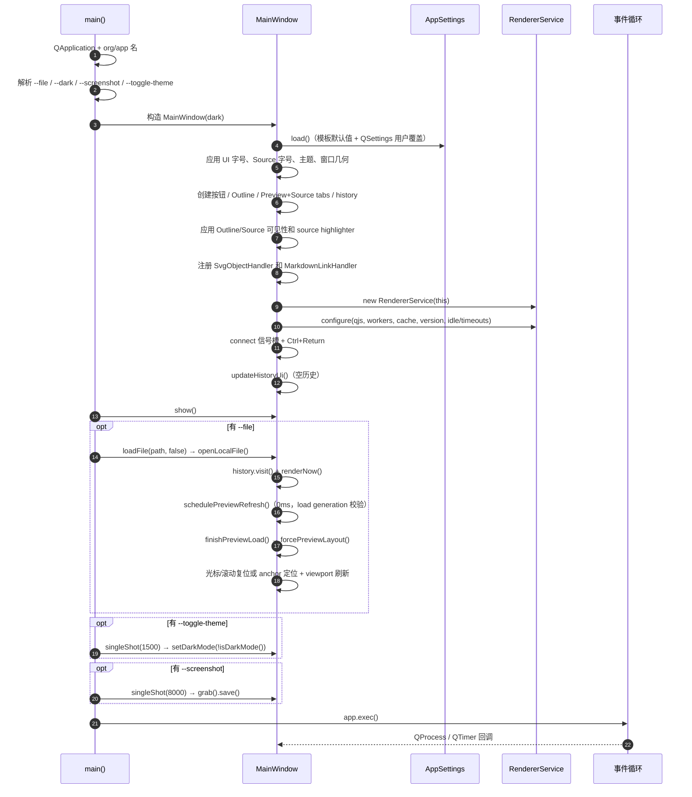

### 1.1 文件加载入口

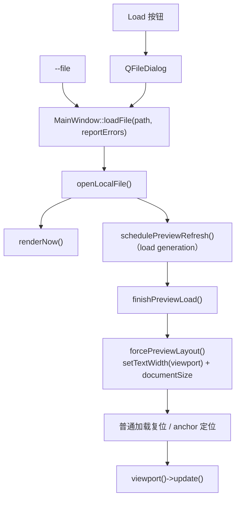

- `--file` 和 `Load` 共用同一条加载和收尾路径；`reportErrors` 只控制错误呈现方式；
- `chooseFile()` 只负责选择路径，不处理加载状态；
- `openLocalFile()` 负责读取、历史、base URL 和渲染编排；
- `renderNow()` 只负责把 Source 转换为 Preview 并调度渲染；
- `finishPreviewLoad()` 必须强制完成整篇文档布局，再执行位置收尾；仅查询 `documentSize()` 不会使部分布局失效；
- 异步 block 完成后再次执行布局校正，并在存在 pending anchor 时重新定位。

---

## 2. 一次渲染的时序

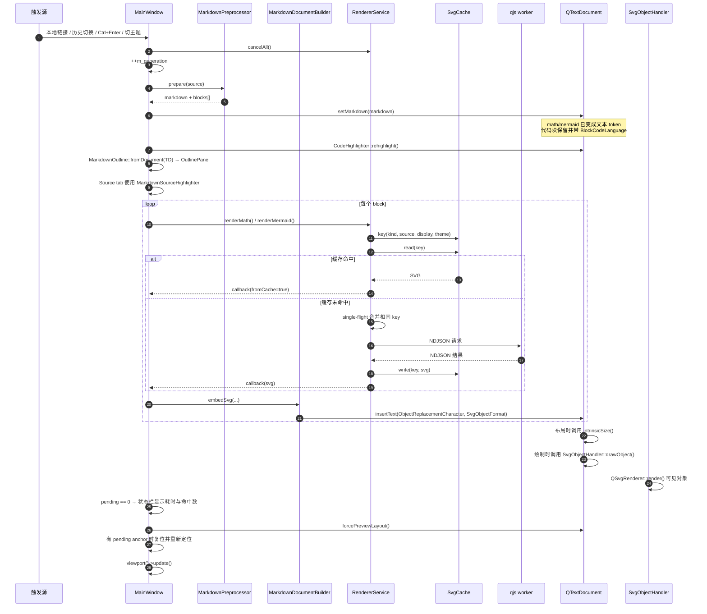

block 为空时，`renderNow()` 在更新状态后返回；加载收尾仍通过 `schedulePreviewRefresh()` 完成完整布局和视口刷新。

---

## 3. 缓存 / worker / single-flight

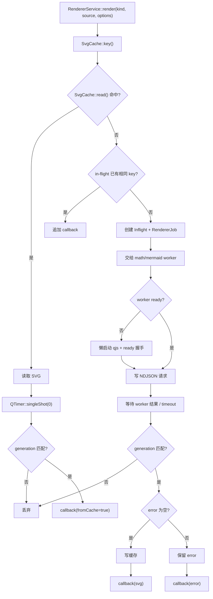

---

## 4. SVG 对象插入与绘制

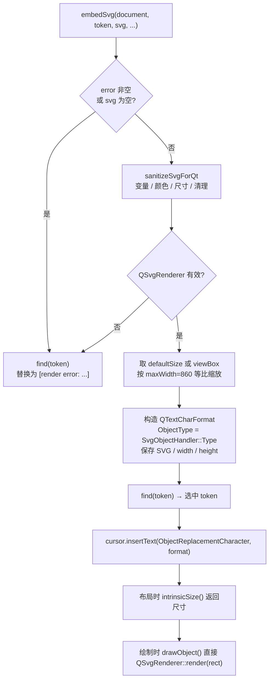

> 这里不再为每个 block 常驻 QImage；400 blocks 的主进程 PSS 从 420MB 降到约 26MB。

---

## 4.1 代码块高亮

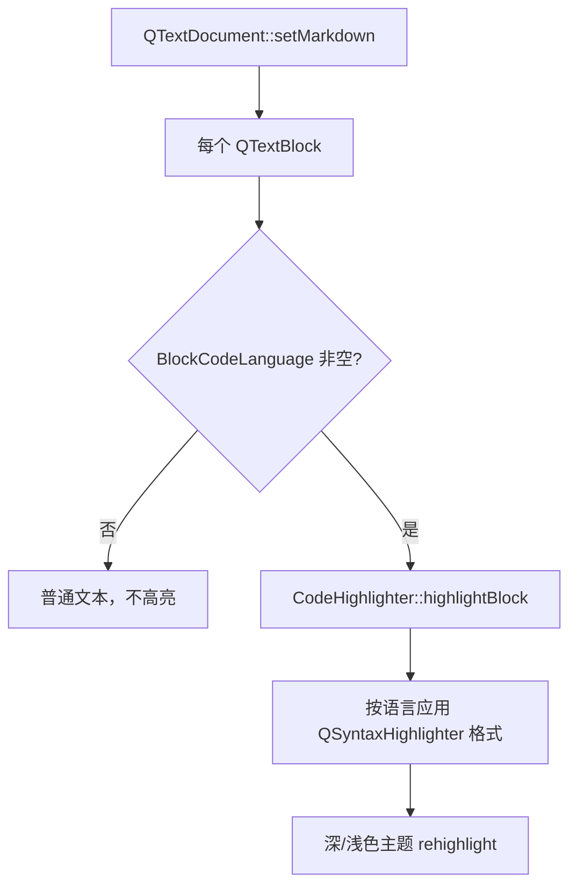

支持的语言：C++ / Python / JavaScript / JSON / Bash / LaTeX。

`latex` 和 `math` fence 仍按代码处理，不自动渲染为公式。

---

## 4.2 链接处理

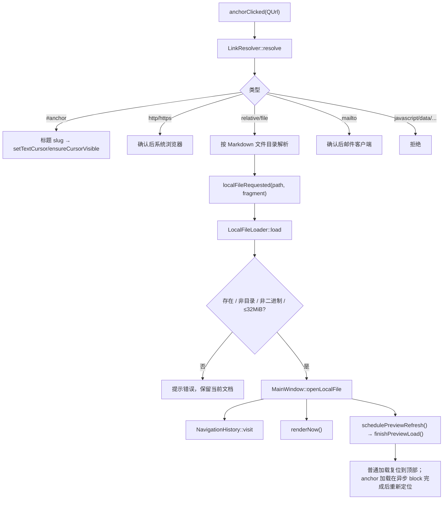

`QTextDocument::setBaseUrl()` 使用当前 Markdown 文件所在目录；没有 base 的相对链接会被拒绝。
本地文件不再调用 `QDesktopServices`，只在当前窗口内重新加载。

### 4.3 本地文件历史

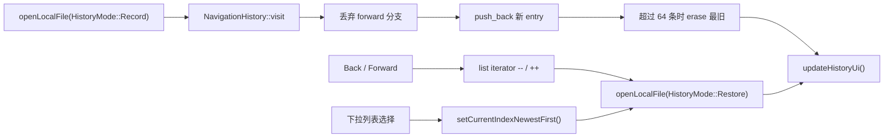

- 使用 `std::list` 双向链表，最多 64 条；
- 最新记录在链表尾部；UI 反转后最新在上；
- 下拉框只显示文件名，tooltip 保存完整路径；
- 打开失败时回滚历史游标，不把坏记录留在当前位置。

### 4.4 目录与设置

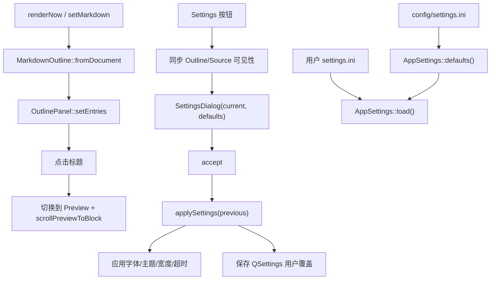

- 模板只读，用户覆盖写入 `QSettings`；
- `--dark` 只覆盖当前进程；
- Source 只读，Markdown 高亮在 Source 文档上运行；
- 目录条目保存 blockNumber，不依靠生成 anchor；
- Outline dock 固定左侧，`Outline` 开关只负责隐藏/显示，不允许浮动或取下。

### 4.5 图片与 SVG 预览

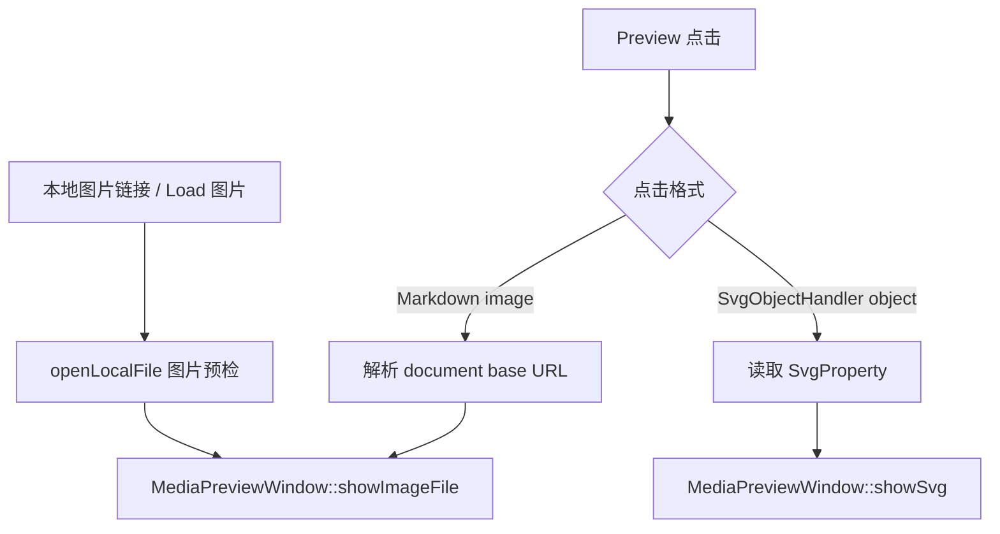

- 图片点击优先于图片外层的链接；
- 图片和 SVG 使用独立的非模态预览窗口；
- 预览窗口使用 `QGraphicsView`，支持 Fit、1:1、5%–800% 缩放、`Ctrl`+滚轮和拖拽平移；
- `Save As` 保存原始栅格图片/SVG，栅格图片可转存其他格式，SVG 可导出 PNG；
- 远程图片不下载。

---

## 5. 取消、generation 与 idle

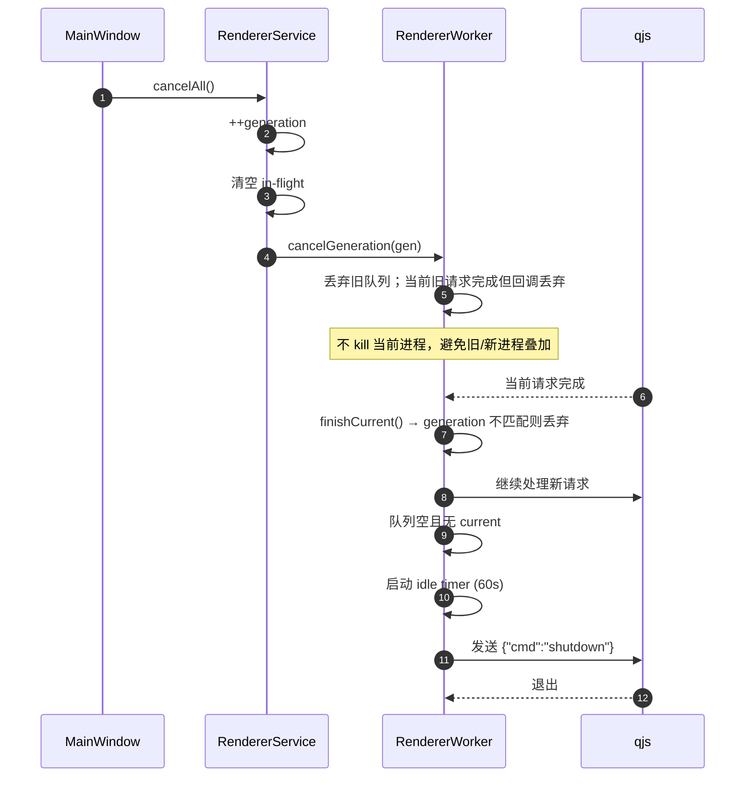

---

## 6. 进程模型

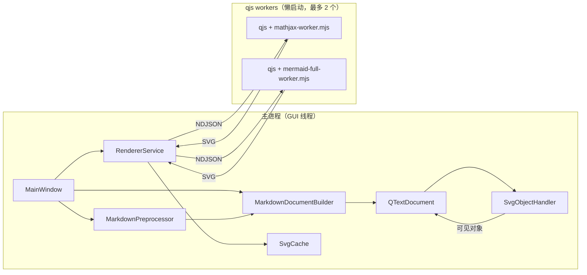

> 进程数上限 2；空闲 60s 退出；worker 有 RLIMIT_AS / RLIMIT_CPU 与请求超时。

---

## 7. UI 主题

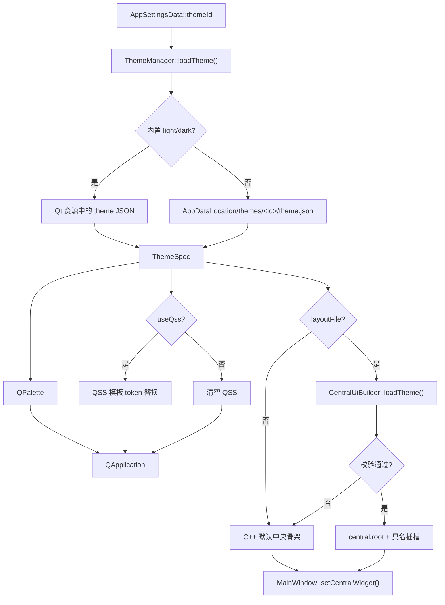

- 用户主题只提供 JSON token、QSS 开关和可选静态 `.ui`，不直接提供任意 QSS 或代码；
- 内置主题保持原有 QPalette 视觉，不启用 QSS，也不带 `.ui`；
- 用户主题默认启用 QSS，由固定模板生成；
- 主题缺失或校验失败时回退到 `light`；
- `.ui` 只替换 `QMainWindow::centralWidget()` 子树；主窗口、状态栏、Outline dock 和渲染 controller 仍由 C++ 持有；
- 必需插槽为 `central.toolbar.leading`、`central.toolbar.trailing`、`central.content`；可选插槽为 `central.top`、`central.bottom`、`central.empty`；
- `central.preview` 和 `central.source` 是 `central.content` 内部标签页的稳定内容插槽；
- `.ui` 只允许标准 Qt 控件和布局；未知控件、`<customwidgets>`、`<resources>`、`<connections>`、外部 URL 和 `styleSheet` 注入会被拒绝；
- `.ui` 缺失、解析失败、插槽缺失或校验失败时回退 C++ 默认中央布局；布局路径无效只拒绝布局，不回退主题颜色；
- 代码高亮、Source 高亮和 Mermaid 仍使用主题的 `dark` 标志；
- 当前不引入 QML。
