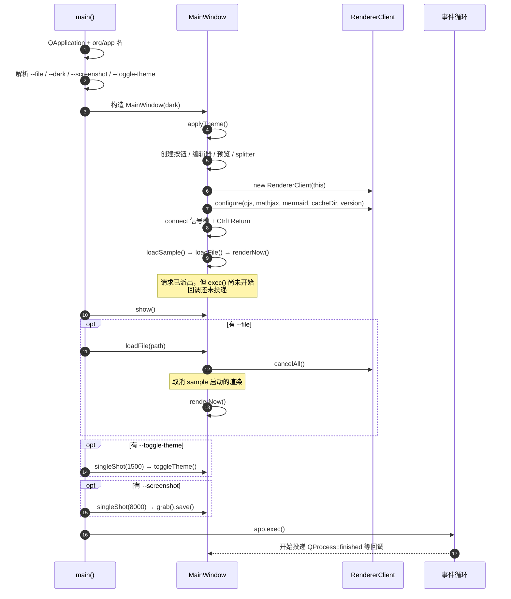
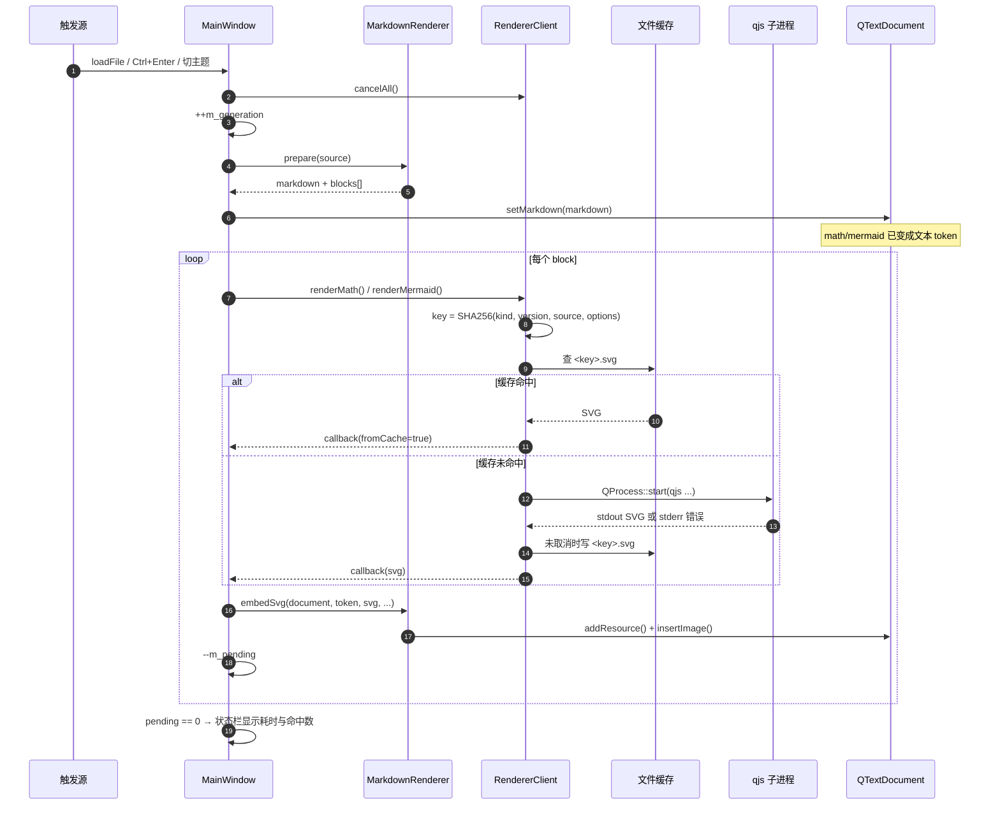
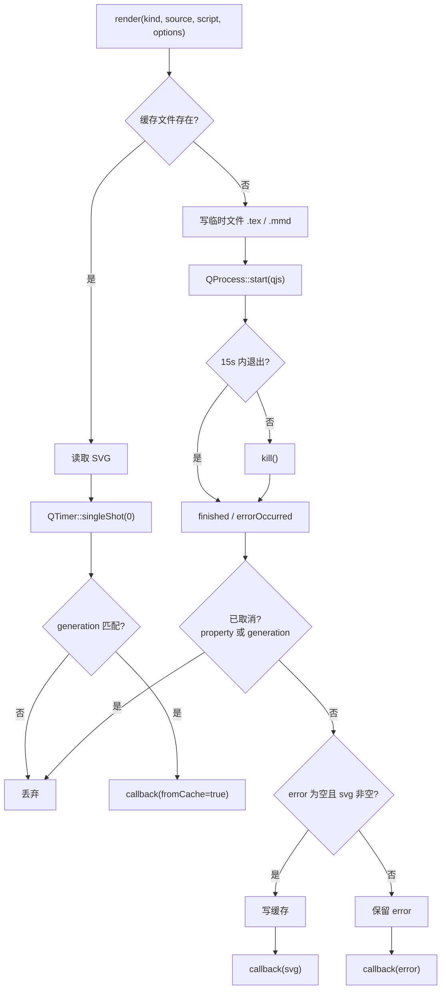
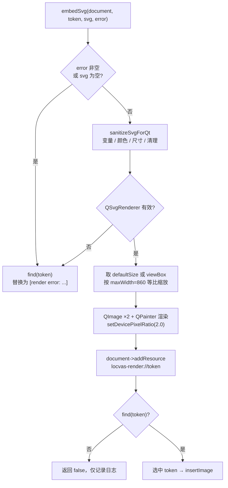
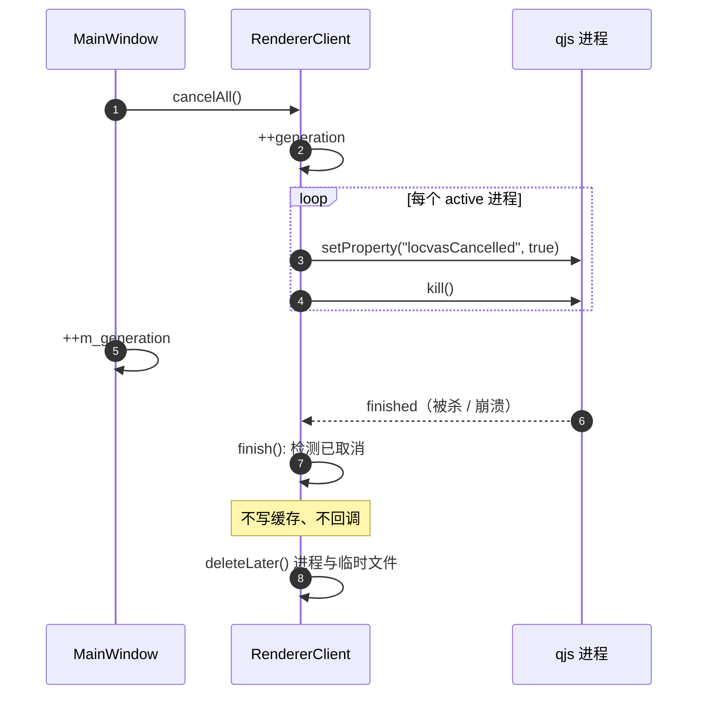
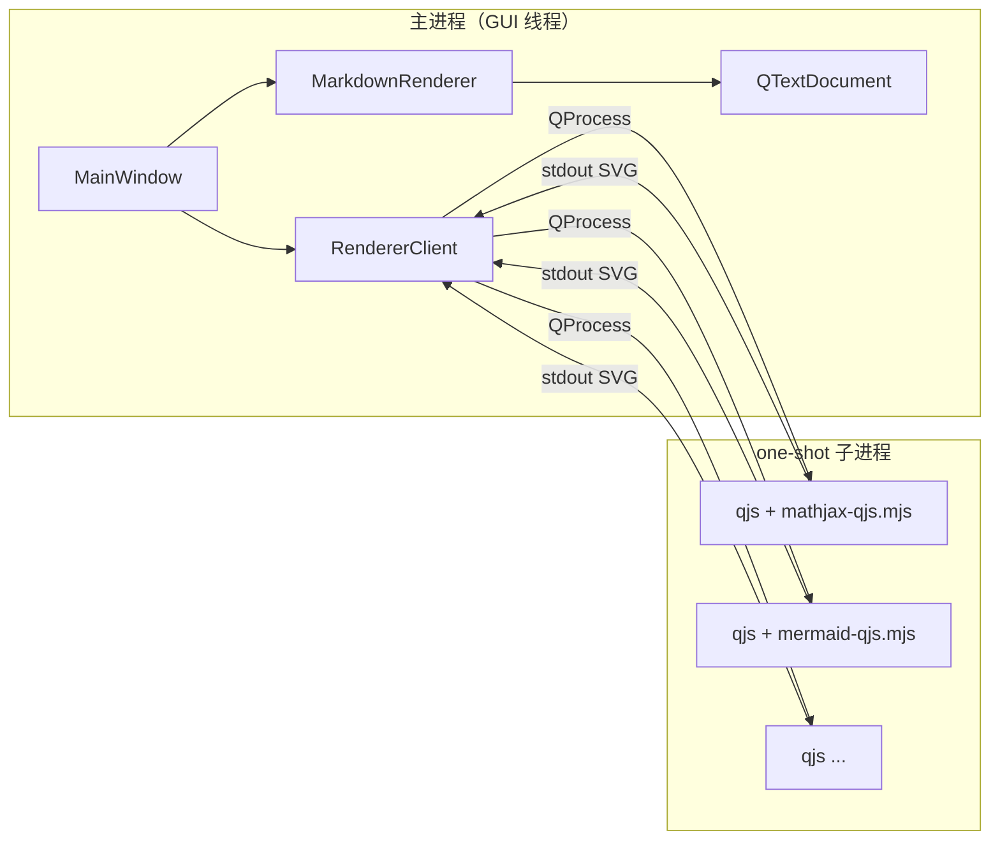

# 程序流程图

> 对应代码：`src/main.cpp`、`src/MainWindow.cpp`、`src/RendererClient.cpp`、`src/MarkdownRenderer.cpp`
>
> 本文件只放流程图；架构与模块说明见 [README.md](../README.md)、[ADR-0001](ADR-0001-rendering-pipeline.md)。

---

## 1. 启动流程

对应：`main.cpp:10-50`、`MainWindow.cpp:52-115`、`MainWindow.cpp:117-127`。

---

## 2. 一次渲染的时序

对应：`MainWindow.cpp:171-247`、`RendererClient.cpp:76-194`、`MarkdownRenderer.cpp:145-219`。

---

## 3. 单个 block 的缓存 / 进程决策

对应：`RendererClient.cpp:82-194`。

---

## 4. SVG 回填与 token 替换

对应：`MarkdownRenderer.cpp:145-219`、`SvgSanitizer.cpp:207-246`。

---

## 5. 取消与 generation

对应：`RendererClient.cpp:35-45`、`RendererClient.cpp:132-153`、`MainWindow.cpp:173-175`。

---

## 6. 进程模型

对应：`RendererClient.cpp:119-193`。

> 当前模型没有并发上限：N 个 block 对应 N 个进程。优化方向见 [TODO.md](../TODO.md) 的“当前优化决策”。
