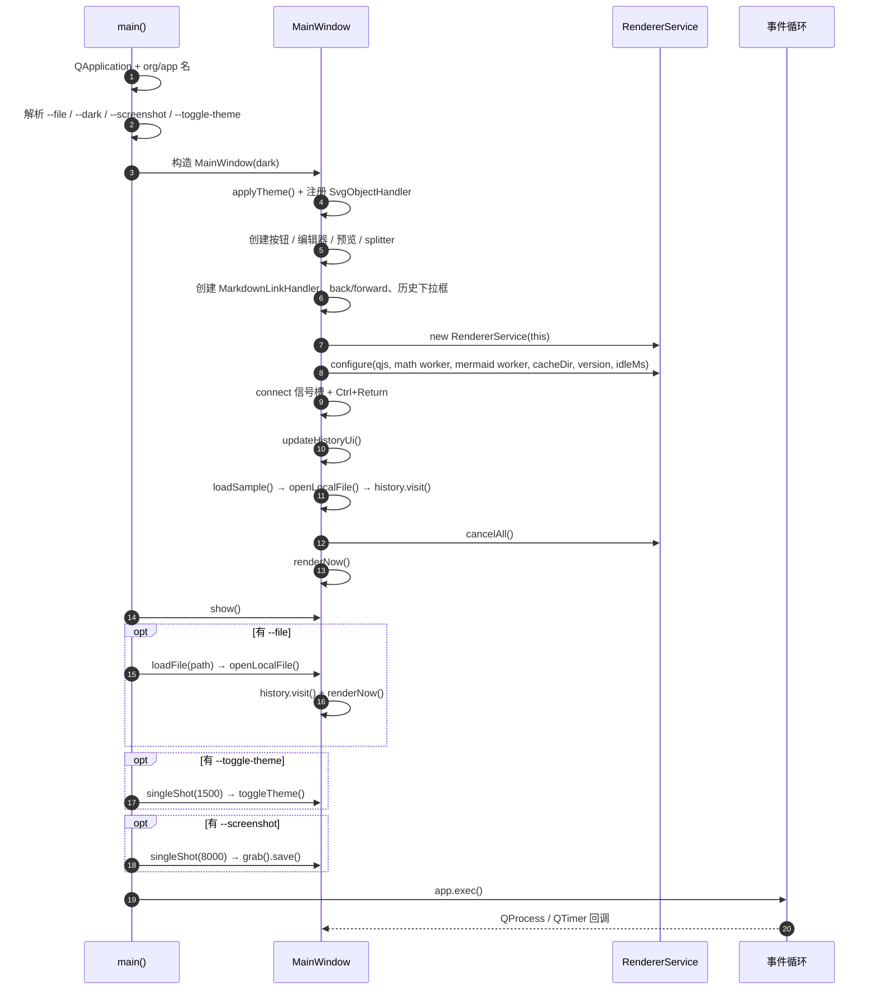
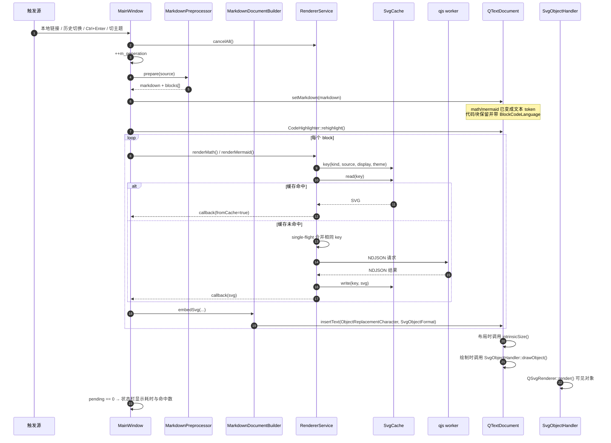
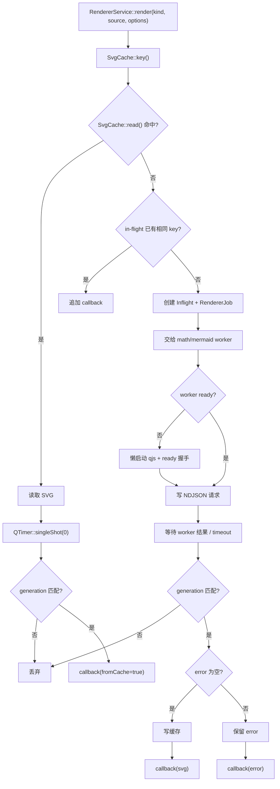
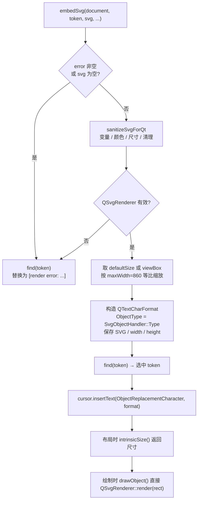
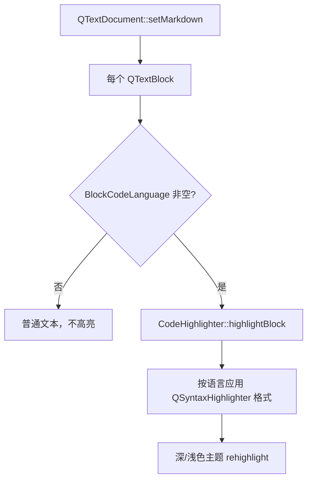
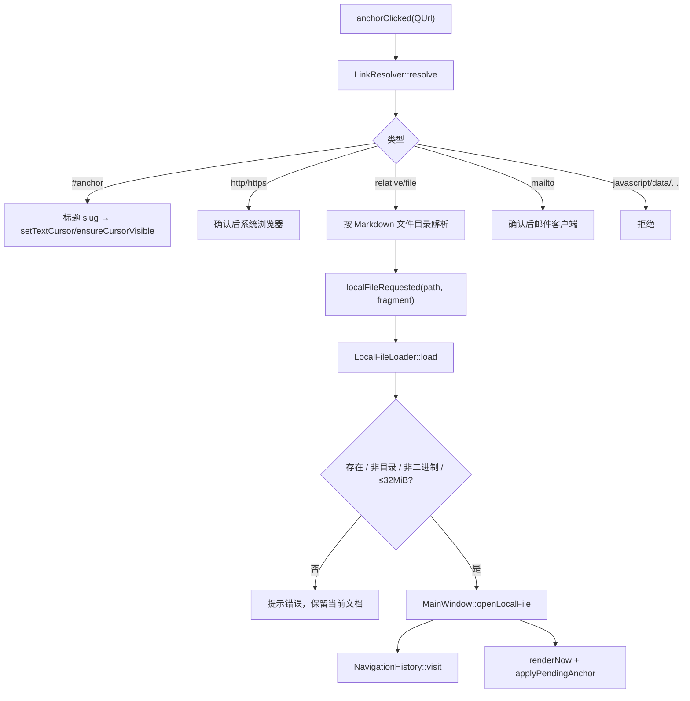
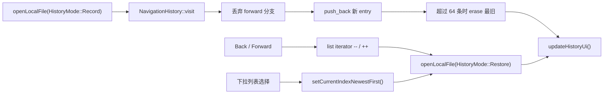
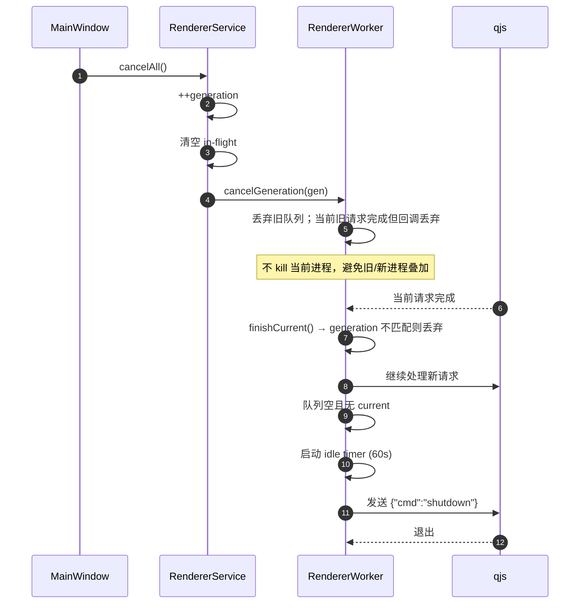
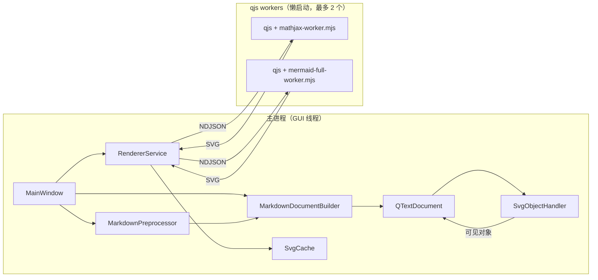

# 程序流程图

> 对应代码：`src/main.cpp`、`src/MainWindow.cpp`、`src/RendererService.cpp`、`src/RendererWorker.cpp`、`src/MarkdownPreprocessor.cpp`、`src/MarkdownDocumentBuilder.cpp`、`src/SvgObjectHandler.cpp`
>
> 本文件只放流程图；架构与模块说明见 [README.md](../README.md)、[ADR-0001](ADR-0001-rendering-pipeline.md)。

---

## 1. 启动流程

---

## 2. 一次渲染的时序

---

## 3. 缓存 / worker / single-flight

---

## 4. SVG 对象插入与绘制

> 这里不再为每个 block 常驻 QImage；400 blocks 的主进程 PSS 从 420MB 降到约 26MB。

---

## 4.1 代码块高亮

支持的语言：C++ / Python / JavaScript / JSON / Bash / LaTeX。

`latex` 和 `math` fence 仍按代码处理，不自动渲染为公式。

---

## 4.2 链接处理

`QTextDocument::setBaseUrl()` 使用当前 Markdown 文件所在目录；没有 base 的相对链接会被拒绝。
本地文件不再调用 `QDesktopServices`，只在当前窗口内重新加载。

### 4.3 本地文件历史

- 使用 `std::list` 双向链表，最多 64 条；
- 最新记录在链表尾部；UI 反转后最新在上；
- 下拉框只显示文件名，tooltip 保存完整路径；
- 打开失败时回滚历史游标，不把坏记录留在当前位置。

---

## 5. 取消、generation 与 idle

---

## 6. 进程模型

> 进程数上限 2；空闲 60s 退出；worker 有 RLIMIT_AS / RLIMIT_CPU 与请求超时。
