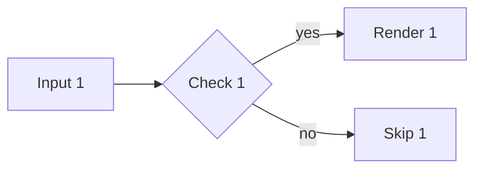
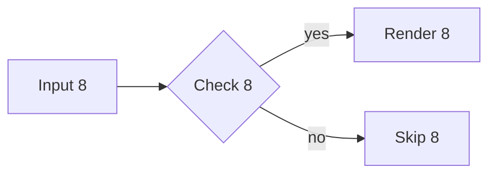
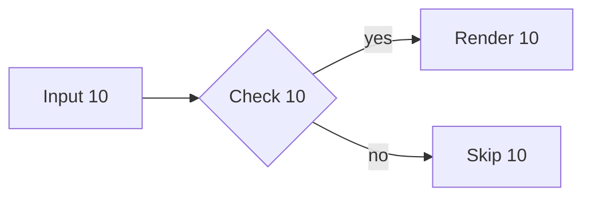

# Benchmark

Inline 1: \(a_1^2 + b_1 = \frac{1}{1}\)

Inline 2: \(a_2^2 + b_2 = \frac{1}{2}\)

Inline 3: \(a_3^2 + b_3 = \frac{1}{3}\)

Inline 4: \(a_4^2 + b_4 = \frac{1}{4}\)

Inline 5: \(a_5^2 + b_5 = \frac{1}{5}\)

Inline 6: \(a_6^2 + b_6 = \frac{1}{6}\)

Inline 7: \(a_7^2 + b_7 = \frac{1}{7}\)

Inline 8: \(a_8^2 + b_8 = \frac{1}{8}\)

Inline 9: \(a_9^2 + b_9 = \frac{1}{9}\)

Inline 10: \(a_10^2 + b_10 = \frac{1}{10}\)

Inline 11: \(a_11^2 + b_11 = \frac{1}{11}\)

Inline 12: \(a_12^2 + b_12 = \frac{1}{12}\)

Inline 13: \(a_13^2 + b_13 = \frac{1}{13}\)

Inline 14: \(a_14^2 + b_14 = \frac{1}{14}\)

Inline 15: \(a_15^2 + b_15 = \frac{1}{15}\)

Inline 16: \(a_16^2 + b_16 = \frac{1}{16}\)

Inline 17: \(a_17^2 + b_17 = \frac{1}{17}\)

Inline 18: \(a_18^2 + b_18 = \frac{1}{18}\)

Inline 19: \(a_19^2 + b_19 = \frac{1}{19}\)

Inline 20: \(a_20^2 + b_20 = \frac{1}{20}\)

