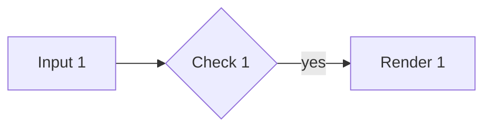
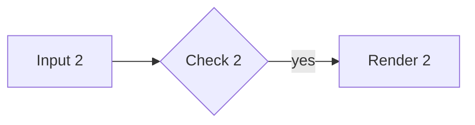
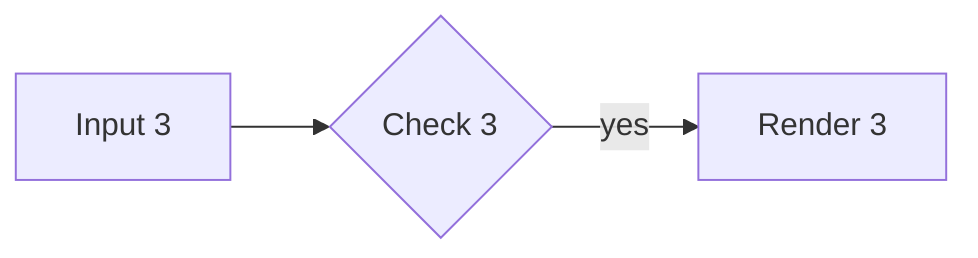
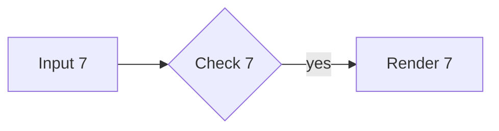
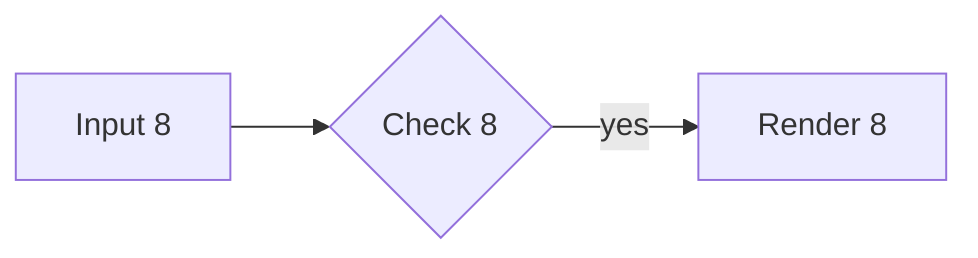
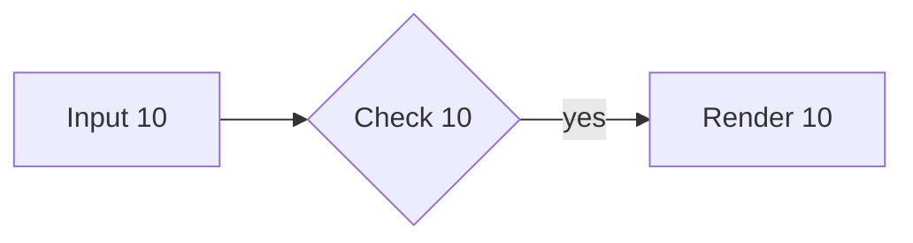
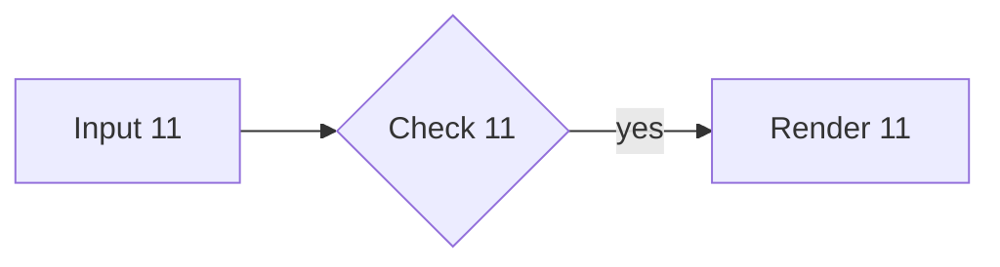
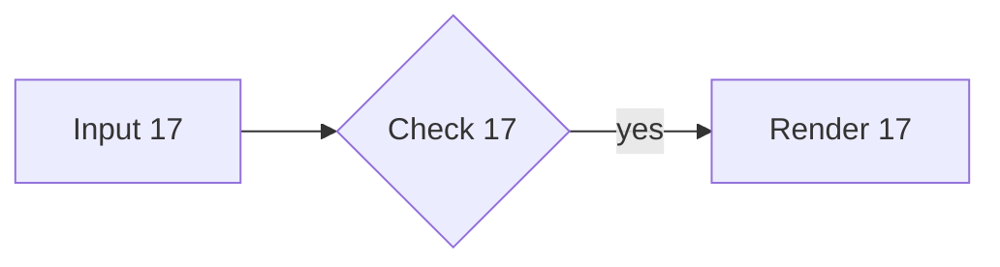
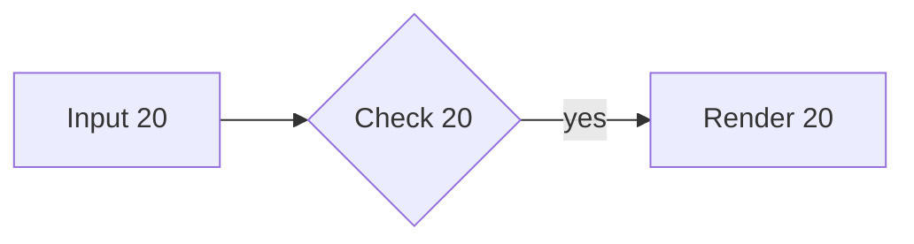

## Message 1

Inline formula 1: \(x_1^2 + y_1 = \frac{a_1}{b_1}\)



## Message 2

Inline formula 2: \(x_2^2 + y_2 = \frac{a_2}{b_2}\)



## Message 3

Inline formula 3: \(x_3^2 + y_3 = \frac{a_3}{b_3}\)



## Message 4

Inline formula 4: \(x_4^2 + y_4 = \frac{a_4}{b_4}\)


## Message 5

Inline formula 5: \(x_5^2 + y_5 = \frac{a_5}{b_5}\)


## Message 6

Inline formula 6: \(x_6^2 + y_6 = \frac{a_6}{b_6}\)


## Message 7

Inline formula 7: \(x_7^2 + y_7 = \frac{a_7}{b_7}\)



## Message 8

Inline formula 8: \(x_8^2 + y_8 = \frac{a_8}{b_8}\)



## Message 9

Inline formula 9: \(x_9^2 + y_9 = \frac{a_9}{b_9}\)


## Message 10

Inline formula 10: \(x_10^2 + y_10 = \frac{a_10}{b_10}\)



## Message 11

Inline formula 11: \(x_11^2 + y_11 = \frac{a_11}{b_11}\)



## Message 12

Inline formula 12: \(x_12^2 + y_12 = \frac{a_12}{b_12}\)


## Message 13

Inline formula 13: \(x_13^2 + y_13 = \frac{a_13}{b_13}\)


## Message 14

Inline formula 14: \(x_14^2 + y_14 = \frac{a_14}{b_14}\)


## Message 15

Inline formula 15: \(x_15^2 + y_15 = \frac{a_15}{b_15}\)


## Message 16

Inline formula 16: \(x_16^2 + y_16 = \frac{a_16}{b_16}\)


## Message 17

Inline formula 17: \(x_17^2 + y_17 = \frac{a_17}{b_17}\)



## Message 18

Inline formula 18: \(x_18^2 + y_18 = \frac{a_18}{b_18}\)


## Message 19

Inline formula 19: \(x_19^2 + y_19 = \frac{a_19}{b_19}\)


## Message 20

Inline formula 20: \(x_20^2 + y_20 = \frac{a_20}{b_20}\)



## Message 21

Inline formula 21: \(x_21^2 + y_21 = \frac{a_21}{b_21}\)

```mermaid
flowchart LR
  A21[Input 21] --> B21{Check 21}
  B21 -- yes --> C21[Render 21]
```

## Message 22

Inline formula 22: \(x_22^2 + y_22 = \frac{a_22}{b_22}\)

```mermaid
flowchart LR
  A22[Input 22] --> B22{Check 22}
  B22 -- yes --> C22[Render 22]
```

## Message 23

Inline formula 23: \(x_23^2 + y_23 = \frac{a_23}{b_23}\)

```mermaid
flowchart LR
  A23[Input 23] --> B23{Check 23}
  B23 -- yes --> C23[Render 23]
```

## Message 24

Inline formula 24: \(x_24^2 + y_24 = \frac{a_24}{b_24}\)

```mermaid
flowchart LR
  A24[Input 24] --> B24{Check 24}
  B24 -- yes --> C24[Render 24]
```

## Message 25

Inline formula 25: \(x_25^2 + y_25 = \frac{a_25}{b_25}\)

```mermaid
flowchart LR
  A25[Input 25] --> B25{Check 25}
  B25 -- yes --> C25[Render 25]
```

## Message 26

Inline formula 26: \(x_26^2 + y_26 = \frac{a_26}{b_26}\)

```mermaid
flowchart LR
  A26[Input 26] --> B26{Check 26}
  B26 -- yes --> C26[Render 26]
```

## Message 27

Inline formula 27: \(x_27^2 + y_27 = \frac{a_27}{b_27}\)

```mermaid
flowchart LR
  A27[Input 27] --> B27{Check 27}
  B27 -- yes --> C27[Render 27]
```

## Message 28

Inline formula 28: \(x_28^2 + y_28 = \frac{a_28}{b_28}\)

```mermaid
flowchart LR
  A28[Input 28] --> B28{Check 28}
  B28 -- yes --> C28[Render 28]
```

## Message 29

Inline formula 29: \(x_29^2 + y_29 = \frac{a_29}{b_29}\)

```mermaid
flowchart LR
  A29[Input 29] --> B29{Check 29}
  B29 -- yes --> C29[Render 29]
```

## Message 30

Inline formula 30: \(x_30^2 + y_30 = \frac{a_30}{b_30}\)

```mermaid
flowchart LR
  A30[Input 30] --> B30{Check 30}
  B30 -- yes --> C30[Render 30]
```

## Message 31

Inline formula 31: \(x_31^2 + y_31 = \frac{a_31}{b_31}\)

```mermaid
flowchart LR
  A31[Input 31] --> B31{Check 31}
  B31 -- yes --> C31[Render 31]
```

## Message 32

Inline formula 32: \(x_32^2 + y_32 = \frac{a_32}{b_32}\)

```mermaid
flowchart LR
  A32[Input 32] --> B32{Check 32}
  B32 -- yes --> C32[Render 32]
```

## Message 33

Inline formula 33: \(x_33^2 + y_33 = \frac{a_33}{b_33}\)

```mermaid
flowchart LR
  A33[Input 33] --> B33{Check 33}
  B33 -- yes --> C33[Render 33]
```

## Message 34

Inline formula 34: \(x_34^2 + y_34 = \frac{a_34}{b_34}\)

```mermaid
flowchart LR
  A34[Input 34] --> B34{Check 34}
  B34 -- yes --> C34[Render 34]
```

## Message 35

Inline formula 35: \(x_35^2 + y_35 = \frac{a_35}{b_35}\)

```mermaid
flowchart LR
  A35[Input 35] --> B35{Check 35}
  B35 -- yes --> C35[Render 35]
```

## Message 36

Inline formula 36: \(x_36^2 + y_36 = \frac{a_36}{b_36}\)

```mermaid
flowchart LR
  A36[Input 36] --> B36{Check 36}
  B36 -- yes --> C36[Render 36]
```

## Message 37

Inline formula 37: \(x_37^2 + y_37 = \frac{a_37}{b_37}\)

```mermaid
flowchart LR
  A37[Input 37] --> B37{Check 37}
  B37 -- yes --> C37[Render 37]
```

## Message 38

Inline formula 38: \(x_38^2 + y_38 = \frac{a_38}{b_38}\)

```mermaid
flowchart LR
  A38[Input 38] --> B38{Check 38}
  B38 -- yes --> C38[Render 38]
```

## Message 39

Inline formula 39: \(x_39^2 + y_39 = \frac{a_39}{b_39}\)

```mermaid
flowchart LR
  A39[Input 39] --> B39{Check 39}
  B39 -- yes --> C39[Render 39]
```

## Message 40

Inline formula 40: \(x_40^2 + y_40 = \frac{a_40}{b_40}\)

```mermaid
flowchart LR
  A40[Input 40] --> B40{Check 40}
  B40 -- yes --> C40[Render 40]
```

## Message 41

Inline formula 41: \(x_41^2 + y_41 = \frac{a_41}{b_41}\)

```mermaid
flowchart LR
  A41[Input 41] --> B41{Check 41}
  B41 -- yes --> C41[Render 41]
```

## Message 42

Inline formula 42: \(x_42^2 + y_42 = \frac{a_42}{b_42}\)

```mermaid
flowchart LR
  A42[Input 42] --> B42{Check 42}
  B42 -- yes --> C42[Render 42]
```

## Message 43

Inline formula 43: \(x_43^2 + y_43 = \frac{a_43}{b_43}\)

```mermaid
flowchart LR
  A43[Input 43] --> B43{Check 43}
  B43 -- yes --> C43[Render 43]
```

## Message 44

Inline formula 44: \(x_44^2 + y_44 = \frac{a_44}{b_44}\)

```mermaid
flowchart LR
  A44[Input 44] --> B44{Check 44}
  B44 -- yes --> C44[Render 44]
```

## Message 45

Inline formula 45: \(x_45^2 + y_45 = \frac{a_45}{b_45}\)

```mermaid
flowchart LR
  A45[Input 45] --> B45{Check 45}
  B45 -- yes --> C45[Render 45]
```

## Message 46

Inline formula 46: \(x_46^2 + y_46 = \frac{a_46}{b_46}\)

```mermaid
flowchart LR
  A46[Input 46] --> B46{Check 46}
  B46 -- yes --> C46[Render 46]
```

## Message 47

Inline formula 47: \(x_47^2 + y_47 = \frac{a_47}{b_47}\)

```mermaid
flowchart LR
  A47[Input 47] --> B47{Check 47}
  B47 -- yes --> C47[Render 47]
```

## Message 48

Inline formula 48: \(x_48^2 + y_48 = \frac{a_48}{b_48}\)

```mermaid
flowchart LR
  A48[Input 48] --> B48{Check 48}
  B48 -- yes --> C48[Render 48]
```

## Message 49

Inline formula 49: \(x_49^2 + y_49 = \frac{a_49}{b_49}\)

```mermaid
flowchart LR
  A49[Input 49] --> B49{Check 49}
  B49 -- yes --> C49[Render 49]
```

## Message 50

Inline formula 50: \(x_50^2 + y_50 = \frac{a_50}{b_50}\)

```mermaid
flowchart LR
  A50[Input 50] --> B50{Check 50}
  B50 -- yes --> C50[Render 50]
```

## Message 51

Inline formula 51: \(x_51^2 + y_51 = \frac{a_51}{b_51}\)

```mermaid
flowchart LR
  A51[Input 51] --> B51{Check 51}
  B51 -- yes --> C51[Render 51]
```

## Message 52

Inline formula 52: \(x_52^2 + y_52 = \frac{a_52}{b_52}\)

```mermaid
flowchart LR
  A52[Input 52] --> B52{Check 52}
  B52 -- yes --> C52[Render 52]
```

## Message 53

Inline formula 53: \(x_53^2 + y_53 = \frac{a_53}{b_53}\)

```mermaid
flowchart LR
  A53[Input 53] --> B53{Check 53}
  B53 -- yes --> C53[Render 53]
```

## Message 54

Inline formula 54: \(x_54^2 + y_54 = \frac{a_54}{b_54}\)

```mermaid
flowchart LR
  A54[Input 54] --> B54{Check 54}
  B54 -- yes --> C54[Render 54]
```

## Message 55

Inline formula 55: \(x_55^2 + y_55 = \frac{a_55}{b_55}\)

```mermaid
flowchart LR
  A55[Input 55] --> B55{Check 55}
  B55 -- yes --> C55[Render 55]
```

## Message 56

Inline formula 56: \(x_56^2 + y_56 = \frac{a_56}{b_56}\)

```mermaid
flowchart LR
  A56[Input 56] --> B56{Check 56}
  B56 -- yes --> C56[Render 56]
```

## Message 57

Inline formula 57: \(x_57^2 + y_57 = \frac{a_57}{b_57}\)

```mermaid
flowchart LR
  A57[Input 57] --> B57{Check 57}
  B57 -- yes --> C57[Render 57]
```

## Message 58

Inline formula 58: \(x_58^2 + y_58 = \frac{a_58}{b_58}\)

```mermaid
flowchart LR
  A58[Input 58] --> B58{Check 58}
  B58 -- yes --> C58[Render 58]
```

## Message 59

Inline formula 59: \(x_59^2 + y_59 = \frac{a_59}{b_59}\)

```mermaid
flowchart LR
  A59[Input 59] --> B59{Check 59}
  B59 -- yes --> C59[Render 59]
```

## Message 60

Inline formula 60: \(x_60^2 + y_60 = \frac{a_60}{b_60}\)

```mermaid
flowchart LR
  A60[Input 60] --> B60{Check 60}
  B60 -- yes --> C60[Render 60]
```

## Message 61

Inline formula 61: \(x_61^2 + y_61 = \frac{a_61}{b_61}\)

```mermaid
flowchart LR
  A61[Input 61] --> B61{Check 61}
  B61 -- yes --> C61[Render 61]
```

## Message 62

Inline formula 62: \(x_62^2 + y_62 = \frac{a_62}{b_62}\)

```mermaid
flowchart LR
  A62[Input 62] --> B62{Check 62}
  B62 -- yes --> C62[Render 62]
```

## Message 63

Inline formula 63: \(x_63^2 + y_63 = \frac{a_63}{b_63}\)

```mermaid
flowchart LR
  A63[Input 63] --> B63{Check 63}
  B63 -- yes --> C63[Render 63]
```

## Message 64

Inline formula 64: \(x_64^2 + y_64 = \frac{a_64}{b_64}\)

```mermaid
flowchart LR
  A64[Input 64] --> B64{Check 64}
  B64 -- yes --> C64[Render 64]
```

## Message 65

Inline formula 65: \(x_65^2 + y_65 = \frac{a_65}{b_65}\)

```mermaid
flowchart LR
  A65[Input 65] --> B65{Check 65}
  B65 -- yes --> C65[Render 65]
```

## Message 66

Inline formula 66: \(x_66^2 + y_66 = \frac{a_66}{b_66}\)

```mermaid
flowchart LR
  A66[Input 66] --> B66{Check 66}
  B66 -- yes --> C66[Render 66]
```

## Message 67

Inline formula 67: \(x_67^2 + y_67 = \frac{a_67}{b_67}\)

```mermaid
flowchart LR
  A67[Input 67] --> B67{Check 67}
  B67 -- yes --> C67[Render 67]
```

## Message 68

Inline formula 68: \(x_68^2 + y_68 = \frac{a_68}{b_68}\)

```mermaid
flowchart LR
  A68[Input 68] --> B68{Check 68}
  B68 -- yes --> C68[Render 68]
```

## Message 69

Inline formula 69: \(x_69^2 + y_69 = \frac{a_69}{b_69}\)

```mermaid
flowchart LR
  A69[Input 69] --> B69{Check 69}
  B69 -- yes --> C69[Render 69]
```

## Message 70

Inline formula 70: \(x_70^2 + y_70 = \frac{a_70}{b_70}\)

```mermaid
flowchart LR
  A70[Input 70] --> B70{Check 70}
  B70 -- yes --> C70[Render 70]
```

## Message 71

Inline formula 71: \(x_71^2 + y_71 = \frac{a_71}{b_71}\)

```mermaid
flowchart LR
  A71[Input 71] --> B71{Check 71}
  B71 -- yes --> C71[Render 71]
```

## Message 72

Inline formula 72: \(x_72^2 + y_72 = \frac{a_72}{b_72}\)

```mermaid
flowchart LR
  A72[Input 72] --> B72{Check 72}
  B72 -- yes --> C72[Render 72]
```

## Message 73

Inline formula 73: \(x_73^2 + y_73 = \frac{a_73}{b_73}\)

```mermaid
flowchart LR
  A73[Input 73] --> B73{Check 73}
  B73 -- yes --> C73[Render 73]
```

## Message 74

Inline formula 74: \(x_74^2 + y_74 = \frac{a_74}{b_74}\)

```mermaid
flowchart LR
  A74[Input 74] --> B74{Check 74}
  B74 -- yes --> C74[Render 74]
```

## Message 75

Inline formula 75: \(x_75^2 + y_75 = \frac{a_75}{b_75}\)

```mermaid
flowchart LR
  A75[Input 75] --> B75{Check 75}
  B75 -- yes --> C75[Render 75]
```

## Message 76

Inline formula 76: \(x_76^2 + y_76 = \frac{a_76}{b_76}\)

```mermaid
flowchart LR
  A76[Input 76] --> B76{Check 76}
  B76 -- yes --> C76[Render 76]
```

## Message 77

Inline formula 77: \(x_77^2 + y_77 = \frac{a_77}{b_77}\)

```mermaid
flowchart LR
  A77[Input 77] --> B77{Check 77}
  B77 -- yes --> C77[Render 77]
```

## Message 78

Inline formula 78: \(x_78^2 + y_78 = \frac{a_78}{b_78}\)

```mermaid
flowchart LR
  A78[Input 78] --> B78{Check 78}
  B78 -- yes --> C78[Render 78]
```

## Message 79

Inline formula 79: \(x_79^2 + y_79 = \frac{a_79}{b_79}\)

```mermaid
flowchart LR
  A79[Input 79] --> B79{Check 79}
  B79 -- yes --> C79[Render 79]
```

## Message 80

Inline formula 80: \(x_80^2 + y_80 = \frac{a_80}{b_80}\)

```mermaid
flowchart LR
  A80[Input 80] --> B80{Check 80}
  B80 -- yes --> C80[Render 80]
```

## Message 81

Inline formula 81: \(x_81^2 + y_81 = \frac{a_81}{b_81}\)

```mermaid
flowchart LR
  A81[Input 81] --> B81{Check 81}
  B81 -- yes --> C81[Render 81]
```

## Message 82

Inline formula 82: \(x_82^2 + y_82 = \frac{a_82}{b_82}\)

```mermaid
flowchart LR
  A82[Input 82] --> B82{Check 82}
  B82 -- yes --> C82[Render 82]
```

## Message 83

Inline formula 83: \(x_83^2 + y_83 = \frac{a_83}{b_83}\)

```mermaid
flowchart LR
  A83[Input 83] --> B83{Check 83}
  B83 -- yes --> C83[Render 83]
```

## Message 84

Inline formula 84: \(x_84^2 + y_84 = \frac{a_84}{b_84}\)

```mermaid
flowchart LR
  A84[Input 84] --> B84{Check 84}
  B84 -- yes --> C84[Render 84]
```

## Message 85

Inline formula 85: \(x_85^2 + y_85 = \frac{a_85}{b_85}\)

```mermaid
flowchart LR
  A85[Input 85] --> B85{Check 85}
  B85 -- yes --> C85[Render 85]
```

## Message 86

Inline formula 86: \(x_86^2 + y_86 = \frac{a_86}{b_86}\)

```mermaid
flowchart LR
  A86[Input 86] --> B86{Check 86}
  B86 -- yes --> C86[Render 86]
```

## Message 87

Inline formula 87: \(x_87^2 + y_87 = \frac{a_87}{b_87}\)

```mermaid
flowchart LR
  A87[Input 87] --> B87{Check 87}
  B87 -- yes --> C87[Render 87]
```

## Message 88

Inline formula 88: \(x_88^2 + y_88 = \frac{a_88}{b_88}\)

```mermaid
flowchart LR
  A88[Input 88] --> B88{Check 88}
  B88 -- yes --> C88[Render 88]
```

## Message 89

Inline formula 89: \(x_89^2 + y_89 = \frac{a_89}{b_89}\)

```mermaid
flowchart LR
  A89[Input 89] --> B89{Check 89}
  B89 -- yes --> C89[Render 89]
```

## Message 90

Inline formula 90: \(x_90^2 + y_90 = \frac{a_90}{b_90}\)

```mermaid
flowchart LR
  A90[Input 90] --> B90{Check 90}
  B90 -- yes --> C90[Render 90]
```

## Message 91

Inline formula 91: \(x_91^2 + y_91 = \frac{a_91}{b_91}\)

```mermaid
flowchart LR
  A91[Input 91] --> B91{Check 91}
  B91 -- yes --> C91[Render 91]
```

## Message 92

Inline formula 92: \(x_92^2 + y_92 = \frac{a_92}{b_92}\)

```mermaid
flowchart LR
  A92[Input 92] --> B92{Check 92}
  B92 -- yes --> C92[Render 92]
```

## Message 93

Inline formula 93: \(x_93^2 + y_93 = \frac{a_93}{b_93}\)

```mermaid
flowchart LR
  A93[Input 93] --> B93{Check 93}
  B93 -- yes --> C93[Render 93]
```

## Message 94

Inline formula 94: \(x_94^2 + y_94 = \frac{a_94}{b_94}\)

```mermaid
flowchart LR
  A94[Input 94] --> B94{Check 94}
  B94 -- yes --> C94[Render 94]
```

## Message 95

Inline formula 95: \(x_95^2 + y_95 = \frac{a_95}{b_95}\)

```mermaid
flowchart LR
  A95[Input 95] --> B95{Check 95}
  B95 -- yes --> C95[Render 95]
```

## Message 96

Inline formula 96: \(x_96^2 + y_96 = \frac{a_96}{b_96}\)

```mermaid
flowchart LR
  A96[Input 96] --> B96{Check 96}
  B96 -- yes --> C96[Render 96]
```

## Message 97

Inline formula 97: \(x_97^2 + y_97 = \frac{a_97}{b_97}\)

```mermaid
flowchart LR
  A97[Input 97] --> B97{Check 97}
  B97 -- yes --> C97[Render 97]
```

## Message 98

Inline formula 98: \(x_98^2 + y_98 = \frac{a_98}{b_98}\)

```mermaid
flowchart LR
  A98[Input 98] --> B98{Check 98}
  B98 -- yes --> C98[Render 98]
```

## Message 99

Inline formula 99: \(x_99^2 + y_99 = \frac{a_99}{b_99}\)

```mermaid
flowchart LR
  A99[Input 99] --> B99{Check 99}
  B99 -- yes --> C99[Render 99]
```

## Message 100

Inline formula 100: \(x_100^2 + y_100 = \frac{a_100}{b_100}\)

```mermaid
flowchart LR
  A100[Input 100] --> B100{Check 100}
  B100 -- yes --> C100[Render 100]
```

## Message 101

Inline formula 101: \(x_101^2 + y_101 = \frac{a_101}{b_101}\)

```mermaid
flowchart LR
  A101[Input 101] --> B101{Check 101}
  B101 -- yes --> C101[Render 101]
```

## Message 102

Inline formula 102: \(x_102^2 + y_102 = \frac{a_102}{b_102}\)

```mermaid
flowchart LR
  A102[Input 102] --> B102{Check 102}
  B102 -- yes --> C102[Render 102]
```

## Message 103

Inline formula 103: \(x_103^2 + y_103 = \frac{a_103}{b_103}\)

```mermaid
flowchart LR
  A103[Input 103] --> B103{Check 103}
  B103 -- yes --> C103[Render 103]
```

## Message 104

Inline formula 104: \(x_104^2 + y_104 = \frac{a_104}{b_104}\)

```mermaid
flowchart LR
  A104[Input 104] --> B104{Check 104}
  B104 -- yes --> C104[Render 104]
```

## Message 105

Inline formula 105: \(x_105^2 + y_105 = \frac{a_105}{b_105}\)

```mermaid
flowchart LR
  A105[Input 105] --> B105{Check 105}
  B105 -- yes --> C105[Render 105]
```

## Message 106

Inline formula 106: \(x_106^2 + y_106 = \frac{a_106}{b_106}\)

```mermaid
flowchart LR
  A106[Input 106] --> B106{Check 106}
  B106 -- yes --> C106[Render 106]
```

## Message 107

Inline formula 107: \(x_107^2 + y_107 = \frac{a_107}{b_107}\)

```mermaid
flowchart LR
  A107[Input 107] --> B107{Check 107}
  B107 -- yes --> C107[Render 107]
```

## Message 108

Inline formula 108: \(x_108^2 + y_108 = \frac{a_108}{b_108}\)

```mermaid
flowchart LR
  A108[Input 108] --> B108{Check 108}
  B108 -- yes --> C108[Render 108]
```

## Message 109

Inline formula 109: \(x_109^2 + y_109 = \frac{a_109}{b_109}\)

```mermaid
flowchart LR
  A109[Input 109] --> B109{Check 109}
  B109 -- yes --> C109[Render 109]
```

## Message 110

Inline formula 110: \(x_110^2 + y_110 = \frac{a_110}{b_110}\)

```mermaid
flowchart LR
  A110[Input 110] --> B110{Check 110}
  B110 -- yes --> C110[Render 110]
```

## Message 111

Inline formula 111: \(x_111^2 + y_111 = \frac{a_111}{b_111}\)

```mermaid
flowchart LR
  A111[Input 111] --> B111{Check 111}
  B111 -- yes --> C111[Render 111]
```

## Message 112

Inline formula 112: \(x_112^2 + y_112 = \frac{a_112}{b_112}\)

```mermaid
flowchart LR
  A112[Input 112] --> B112{Check 112}
  B112 -- yes --> C112[Render 112]
```

## Message 113

Inline formula 113: \(x_113^2 + y_113 = \frac{a_113}{b_113}\)

```mermaid
flowchart LR
  A113[Input 113] --> B113{Check 113}
  B113 -- yes --> C113[Render 113]
```

## Message 114

Inline formula 114: \(x_114^2 + y_114 = \frac{a_114}{b_114}\)

```mermaid
flowchart LR
  A114[Input 114] --> B114{Check 114}
  B114 -- yes --> C114[Render 114]
```

## Message 115

Inline formula 115: \(x_115^2 + y_115 = \frac{a_115}{b_115}\)

```mermaid
flowchart LR
  A115[Input 115] --> B115{Check 115}
  B115 -- yes --> C115[Render 115]
```

## Message 116

Inline formula 116: \(x_116^2 + y_116 = \frac{a_116}{b_116}\)

```mermaid
flowchart LR
  A116[Input 116] --> B116{Check 116}
  B116 -- yes --> C116[Render 116]
```

## Message 117

Inline formula 117: \(x_117^2 + y_117 = \frac{a_117}{b_117}\)

```mermaid
flowchart LR
  A117[Input 117] --> B117{Check 117}
  B117 -- yes --> C117[Render 117]
```

## Message 118

Inline formula 118: \(x_118^2 + y_118 = \frac{a_118}{b_118}\)

```mermaid
flowchart LR
  A118[Input 118] --> B118{Check 118}
  B118 -- yes --> C118[Render 118]
```

## Message 119

Inline formula 119: \(x_119^2 + y_119 = \frac{a_119}{b_119}\)

```mermaid
flowchart LR
  A119[Input 119] --> B119{Check 119}
  B119 -- yes --> C119[Render 119]
```

## Message 120

Inline formula 120: \(x_120^2 + y_120 = \frac{a_120}{b_120}\)

```mermaid
flowchart LR
  A120[Input 120] --> B120{Check 120}
  B120 -- yes --> C120[Render 120]
```

## Message 121

Inline formula 121: \(x_121^2 + y_121 = \frac{a_121}{b_121}\)

```mermaid
flowchart LR
  A121[Input 121] --> B121{Check 121}
  B121 -- yes --> C121[Render 121]
```

## Message 122

Inline formula 122: \(x_122^2 + y_122 = \frac{a_122}{b_122}\)

```mermaid
flowchart LR
  A122[Input 122] --> B122{Check 122}
  B122 -- yes --> C122[Render 122]
```

## Message 123

Inline formula 123: \(x_123^2 + y_123 = \frac{a_123}{b_123}\)

```mermaid
flowchart LR
  A123[Input 123] --> B123{Check 123}
  B123 -- yes --> C123[Render 123]
```

## Message 124

Inline formula 124: \(x_124^2 + y_124 = \frac{a_124}{b_124}\)

```mermaid
flowchart LR
  A124[Input 124] --> B124{Check 124}
  B124 -- yes --> C124[Render 124]
```

## Message 125

Inline formula 125: \(x_125^2 + y_125 = \frac{a_125}{b_125}\)

```mermaid
flowchart LR
  A125[Input 125] --> B125{Check 125}
  B125 -- yes --> C125[Render 125]
```

## Message 126

Inline formula 126: \(x_126^2 + y_126 = \frac{a_126}{b_126}\)

```mermaid
flowchart LR
  A126[Input 126] --> B126{Check 126}
  B126 -- yes --> C126[Render 126]
```

## Message 127

Inline formula 127: \(x_127^2 + y_127 = \frac{a_127}{b_127}\)

```mermaid
flowchart LR
  A127[Input 127] --> B127{Check 127}
  B127 -- yes --> C127[Render 127]
```

## Message 128

Inline formula 128: \(x_128^2 + y_128 = \frac{a_128}{b_128}\)

```mermaid
flowchart LR
  A128[Input 128] --> B128{Check 128}
  B128 -- yes --> C128[Render 128]
```

## Message 129

Inline formula 129: \(x_129^2 + y_129 = \frac{a_129}{b_129}\)

```mermaid
flowchart LR
  A129[Input 129] --> B129{Check 129}
  B129 -- yes --> C129[Render 129]
```

## Message 130

Inline formula 130: \(x_130^2 + y_130 = \frac{a_130}{b_130}\)

```mermaid
flowchart LR
  A130[Input 130] --> B130{Check 130}
  B130 -- yes --> C130[Render 130]
```

## Message 131

Inline formula 131: \(x_131^2 + y_131 = \frac{a_131}{b_131}\)

```mermaid
flowchart LR
  A131[Input 131] --> B131{Check 131}
  B131 -- yes --> C131[Render 131]
```

## Message 132

Inline formula 132: \(x_132^2 + y_132 = \frac{a_132}{b_132}\)

```mermaid
flowchart LR
  A132[Input 132] --> B132{Check 132}
  B132 -- yes --> C132[Render 132]
```

## Message 133

Inline formula 133: \(x_133^2 + y_133 = \frac{a_133}{b_133}\)

```mermaid
flowchart LR
  A133[Input 133] --> B133{Check 133}
  B133 -- yes --> C133[Render 133]
```

## Message 134

Inline formula 134: \(x_134^2 + y_134 = \frac{a_134}{b_134}\)

```mermaid
flowchart LR
  A134[Input 134] --> B134{Check 134}
  B134 -- yes --> C134[Render 134]
```

## Message 135

Inline formula 135: \(x_135^2 + y_135 = \frac{a_135}{b_135}\)

```mermaid
flowchart LR
  A135[Input 135] --> B135{Check 135}
  B135 -- yes --> C135[Render 135]
```

## Message 136

Inline formula 136: \(x_136^2 + y_136 = \frac{a_136}{b_136}\)

```mermaid
flowchart LR
  A136[Input 136] --> B136{Check 136}
  B136 -- yes --> C136[Render 136]
```

## Message 137

Inline formula 137: \(x_137^2 + y_137 = \frac{a_137}{b_137}\)

```mermaid
flowchart LR
  A137[Input 137] --> B137{Check 137}
  B137 -- yes --> C137[Render 137]
```

## Message 138

Inline formula 138: \(x_138^2 + y_138 = \frac{a_138}{b_138}\)

```mermaid
flowchart LR
  A138[Input 138] --> B138{Check 138}
  B138 -- yes --> C138[Render 138]
```

## Message 139

Inline formula 139: \(x_139^2 + y_139 = \frac{a_139}{b_139}\)

```mermaid
flowchart LR
  A139[Input 139] --> B139{Check 139}
  B139 -- yes --> C139[Render 139]
```

## Message 140

Inline formula 140: \(x_140^2 + y_140 = \frac{a_140}{b_140}\)

```mermaid
flowchart LR
  A140[Input 140] --> B140{Check 140}
  B140 -- yes --> C140[Render 140]
```

## Message 141

Inline formula 141: \(x_141^2 + y_141 = \frac{a_141}{b_141}\)

```mermaid
flowchart LR
  A141[Input 141] --> B141{Check 141}
  B141 -- yes --> C141[Render 141]
```

## Message 142

Inline formula 142: \(x_142^2 + y_142 = \frac{a_142}{b_142}\)

```mermaid
flowchart LR
  A142[Input 142] --> B142{Check 142}
  B142 -- yes --> C142[Render 142]
```

## Message 143

Inline formula 143: \(x_143^2 + y_143 = \frac{a_143}{b_143}\)

```mermaid
flowchart LR
  A143[Input 143] --> B143{Check 143}
  B143 -- yes --> C143[Render 143]
```

## Message 144

Inline formula 144: \(x_144^2 + y_144 = \frac{a_144}{b_144}\)

```mermaid
flowchart LR
  A144[Input 144] --> B144{Check 144}
  B144 -- yes --> C144[Render 144]
```

## Message 145

Inline formula 145: \(x_145^2 + y_145 = \frac{a_145}{b_145}\)

```mermaid
flowchart LR
  A145[Input 145] --> B145{Check 145}
  B145 -- yes --> C145[Render 145]
```

## Message 146

Inline formula 146: \(x_146^2 + y_146 = \frac{a_146}{b_146}\)

```mermaid
flowchart LR
  A146[Input 146] --> B146{Check 146}
  B146 -- yes --> C146[Render 146]
```

## Message 147

Inline formula 147: \(x_147^2 + y_147 = \frac{a_147}{b_147}\)

```mermaid
flowchart LR
  A147[Input 147] --> B147{Check 147}
  B147 -- yes --> C147[Render 147]
```

## Message 148

Inline formula 148: \(x_148^2 + y_148 = \frac{a_148}{b_148}\)

```mermaid
flowchart LR
  A148[Input 148] --> B148{Check 148}
  B148 -- yes --> C148[Render 148]
```

## Message 149

Inline formula 149: \(x_149^2 + y_149 = \frac{a_149}{b_149}\)

```mermaid
flowchart LR
  A149[Input 149] --> B149{Check 149}
  B149 -- yes --> C149[Render 149]
```

## Message 150

Inline formula 150: \(x_150^2 + y_150 = \frac{a_150}{b_150}\)

```mermaid
flowchart LR
  A150[Input 150] --> B150{Check 150}
  B150 -- yes --> C150[Render 150]
```

## Message 151

Inline formula 151: \(x_151^2 + y_151 = \frac{a_151}{b_151}\)

```mermaid
flowchart LR
  A151[Input 151] --> B151{Check 151}
  B151 -- yes --> C151[Render 151]
```

## Message 152

Inline formula 152: \(x_152^2 + y_152 = \frac{a_152}{b_152}\)

```mermaid
flowchart LR
  A152[Input 152] --> B152{Check 152}
  B152 -- yes --> C152[Render 152]
```

## Message 153

Inline formula 153: \(x_153^2 + y_153 = \frac{a_153}{b_153}\)

```mermaid
flowchart LR
  A153[Input 153] --> B153{Check 153}
  B153 -- yes --> C153[Render 153]
```

## Message 154

Inline formula 154: \(x_154^2 + y_154 = \frac{a_154}{b_154}\)

```mermaid
flowchart LR
  A154[Input 154] --> B154{Check 154}
  B154 -- yes --> C154[Render 154]
```

## Message 155

Inline formula 155: \(x_155^2 + y_155 = \frac{a_155}{b_155}\)

```mermaid
flowchart LR
  A155[Input 155] --> B155{Check 155}
  B155 -- yes --> C155[Render 155]
```

## Message 156

Inline formula 156: \(x_156^2 + y_156 = \frac{a_156}{b_156}\)

```mermaid
flowchart LR
  A156[Input 156] --> B156{Check 156}
  B156 -- yes --> C156[Render 156]
```

## Message 157

Inline formula 157: \(x_157^2 + y_157 = \frac{a_157}{b_157}\)

```mermaid
flowchart LR
  A157[Input 157] --> B157{Check 157}
  B157 -- yes --> C157[Render 157]
```

## Message 158

Inline formula 158: \(x_158^2 + y_158 = \frac{a_158}{b_158}\)

```mermaid
flowchart LR
  A158[Input 158] --> B158{Check 158}
  B158 -- yes --> C158[Render 158]
```

## Message 159

Inline formula 159: \(x_159^2 + y_159 = \frac{a_159}{b_159}\)

```mermaid
flowchart LR
  A159[Input 159] --> B159{Check 159}
  B159 -- yes --> C159[Render 159]
```

## Message 160

Inline formula 160: \(x_160^2 + y_160 = \frac{a_160}{b_160}\)

```mermaid
flowchart LR
  A160[Input 160] --> B160{Check 160}
  B160 -- yes --> C160[Render 160]
```

## Message 161

Inline formula 161: \(x_161^2 + y_161 = \frac{a_161}{b_161}\)

```mermaid
flowchart LR
  A161[Input 161] --> B161{Check 161}
  B161 -- yes --> C161[Render 161]
```

## Message 162

Inline formula 162: \(x_162^2 + y_162 = \frac{a_162}{b_162}\)

```mermaid
flowchart LR
  A162[Input 162] --> B162{Check 162}
  B162 -- yes --> C162[Render 162]
```

## Message 163

Inline formula 163: \(x_163^2 + y_163 = \frac{a_163}{b_163}\)

```mermaid
flowchart LR
  A163[Input 163] --> B163{Check 163}
  B163 -- yes --> C163[Render 163]
```

## Message 164

Inline formula 164: \(x_164^2 + y_164 = \frac{a_164}{b_164}\)

```mermaid
flowchart LR
  A164[Input 164] --> B164{Check 164}
  B164 -- yes --> C164[Render 164]
```

## Message 165

Inline formula 165: \(x_165^2 + y_165 = \frac{a_165}{b_165}\)

```mermaid
flowchart LR
  A165[Input 165] --> B165{Check 165}
  B165 -- yes --> C165[Render 165]
```

## Message 166

Inline formula 166: \(x_166^2 + y_166 = \frac{a_166}{b_166}\)

```mermaid
flowchart LR
  A166[Input 166] --> B166{Check 166}
  B166 -- yes --> C166[Render 166]
```

## Message 167

Inline formula 167: \(x_167^2 + y_167 = \frac{a_167}{b_167}\)

```mermaid
flowchart LR
  A167[Input 167] --> B167{Check 167}
  B167 -- yes --> C167[Render 167]
```

## Message 168

Inline formula 168: \(x_168^2 + y_168 = \frac{a_168}{b_168}\)

```mermaid
flowchart LR
  A168[Input 168] --> B168{Check 168}
  B168 -- yes --> C168[Render 168]
```

## Message 169

Inline formula 169: \(x_169^2 + y_169 = \frac{a_169}{b_169}\)

```mermaid
flowchart LR
  A169[Input 169] --> B169{Check 169}
  B169 -- yes --> C169[Render 169]
```

## Message 170

Inline formula 170: \(x_170^2 + y_170 = \frac{a_170}{b_170}\)

```mermaid
flowchart LR
  A170[Input 170] --> B170{Check 170}
  B170 -- yes --> C170[Render 170]
```

## Message 171

Inline formula 171: \(x_171^2 + y_171 = \frac{a_171}{b_171}\)

```mermaid
flowchart LR
  A171[Input 171] --> B171{Check 171}
  B171 -- yes --> C171[Render 171]
```

## Message 172

Inline formula 172: \(x_172^2 + y_172 = \frac{a_172}{b_172}\)

```mermaid
flowchart LR
  A172[Input 172] --> B172{Check 172}
  B172 -- yes --> C172[Render 172]
```

## Message 173

Inline formula 173: \(x_173^2 + y_173 = \frac{a_173}{b_173}\)

```mermaid
flowchart LR
  A173[Input 173] --> B173{Check 173}
  B173 -- yes --> C173[Render 173]
```

## Message 174

Inline formula 174: \(x_174^2 + y_174 = \frac{a_174}{b_174}\)

```mermaid
flowchart LR
  A174[Input 174] --> B174{Check 174}
  B174 -- yes --> C174[Render 174]
```

## Message 175

Inline formula 175: \(x_175^2 + y_175 = \frac{a_175}{b_175}\)

```mermaid
flowchart LR
  A175[Input 175] --> B175{Check 175}
  B175 -- yes --> C175[Render 175]
```

## Message 176

Inline formula 176: \(x_176^2 + y_176 = \frac{a_176}{b_176}\)

```mermaid
flowchart LR
  A176[Input 176] --> B176{Check 176}
  B176 -- yes --> C176[Render 176]
```

## Message 177

Inline formula 177: \(x_177^2 + y_177 = \frac{a_177}{b_177}\)

```mermaid
flowchart LR
  A177[Input 177] --> B177{Check 177}
  B177 -- yes --> C177[Render 177]
```

## Message 178

Inline formula 178: \(x_178^2 + y_178 = \frac{a_178}{b_178}\)

```mermaid
flowchart LR
  A178[Input 178] --> B178{Check 178}
  B178 -- yes --> C178[Render 178]
```

## Message 179

Inline formula 179: \(x_179^2 + y_179 = \frac{a_179}{b_179}\)

```mermaid
flowchart LR
  A179[Input 179] --> B179{Check 179}
  B179 -- yes --> C179[Render 179]
```

## Message 180

Inline formula 180: \(x_180^2 + y_180 = \frac{a_180}{b_180}\)

```mermaid
flowchart LR
  A180[Input 180] --> B180{Check 180}
  B180 -- yes --> C180[Render 180]
```

## Message 181

Inline formula 181: \(x_181^2 + y_181 = \frac{a_181}{b_181}\)

```mermaid
flowchart LR
  A181[Input 181] --> B181{Check 181}
  B181 -- yes --> C181[Render 181]
```

## Message 182

Inline formula 182: \(x_182^2 + y_182 = \frac{a_182}{b_182}\)

```mermaid
flowchart LR
  A182[Input 182] --> B182{Check 182}
  B182 -- yes --> C182[Render 182]
```

## Message 183

Inline formula 183: \(x_183^2 + y_183 = \frac{a_183}{b_183}\)

```mermaid
flowchart LR
  A183[Input 183] --> B183{Check 183}
  B183 -- yes --> C183[Render 183]
```

## Message 184

Inline formula 184: \(x_184^2 + y_184 = \frac{a_184}{b_184}\)

```mermaid
flowchart LR
  A184[Input 184] --> B184{Check 184}
  B184 -- yes --> C184[Render 184]
```

## Message 185

Inline formula 185: \(x_185^2 + y_185 = \frac{a_185}{b_185}\)

```mermaid
flowchart LR
  A185[Input 185] --> B185{Check 185}
  B185 -- yes --> C185[Render 185]
```

## Message 186

Inline formula 186: \(x_186^2 + y_186 = \frac{a_186}{b_186}\)

```mermaid
flowchart LR
  A186[Input 186] --> B186{Check 186}
  B186 -- yes --> C186[Render 186]
```

## Message 187

Inline formula 187: \(x_187^2 + y_187 = \frac{a_187}{b_187}\)

```mermaid
flowchart LR
  A187[Input 187] --> B187{Check 187}
  B187 -- yes --> C187[Render 187]
```

## Message 188

Inline formula 188: \(x_188^2 + y_188 = \frac{a_188}{b_188}\)

```mermaid
flowchart LR
  A188[Input 188] --> B188{Check 188}
  B188 -- yes --> C188[Render 188]
```

## Message 189

Inline formula 189: \(x_189^2 + y_189 = \frac{a_189}{b_189}\)

```mermaid
flowchart LR
  A189[Input 189] --> B189{Check 189}
  B189 -- yes --> C189[Render 189]
```

## Message 190

Inline formula 190: \(x_190^2 + y_190 = \frac{a_190}{b_190}\)

```mermaid
flowchart LR
  A190[Input 190] --> B190{Check 190}
  B190 -- yes --> C190[Render 190]
```

## Message 191

Inline formula 191: \(x_191^2 + y_191 = \frac{a_191}{b_191}\)

```mermaid
flowchart LR
  A191[Input 191] --> B191{Check 191}
  B191 -- yes --> C191[Render 191]
```

## Message 192

Inline formula 192: \(x_192^2 + y_192 = \frac{a_192}{b_192}\)

```mermaid
flowchart LR
  A192[Input 192] --> B192{Check 192}
  B192 -- yes --> C192[Render 192]
```

## Message 193

Inline formula 193: \(x_193^2 + y_193 = \frac{a_193}{b_193}\)

```mermaid
flowchart LR
  A193[Input 193] --> B193{Check 193}
  B193 -- yes --> C193[Render 193]
```

## Message 194

Inline formula 194: \(x_194^2 + y_194 = \frac{a_194}{b_194}\)

```mermaid
flowchart LR
  A194[Input 194] --> B194{Check 194}
  B194 -- yes --> C194[Render 194]
```

## Message 195

Inline formula 195: \(x_195^2 + y_195 = \frac{a_195}{b_195}\)

```mermaid
flowchart LR
  A195[Input 195] --> B195{Check 195}
  B195 -- yes --> C195[Render 195]
```

## Message 196

Inline formula 196: \(x_196^2 + y_196 = \frac{a_196}{b_196}\)

```mermaid
flowchart LR
  A196[Input 196] --> B196{Check 196}
  B196 -- yes --> C196[Render 196]
```

## Message 197

Inline formula 197: \(x_197^2 + y_197 = \frac{a_197}{b_197}\)

```mermaid
flowchart LR
  A197[Input 197] --> B197{Check 197}
  B197 -- yes --> C197[Render 197]
```

## Message 198

Inline formula 198: \(x_198^2 + y_198 = \frac{a_198}{b_198}\)

```mermaid
flowchart LR
  A198[Input 198] --> B198{Check 198}
  B198 -- yes --> C198[Render 198]
```

## Message 199

Inline formula 199: \(x_199^2 + y_199 = \frac{a_199}{b_199}\)

```mermaid
flowchart LR
  A199[Input 199] --> B199{Check 199}
  B199 -- yes --> C199[Render 199]
```

## Message 200

Inline formula 200: \(x_200^2 + y_200 = \frac{a_200}{b_200}\)

```mermaid
flowchart LR
  A200[Input 200] --> B200{Check 200}
  B200 -- yes --> C200[Render 200]
```
