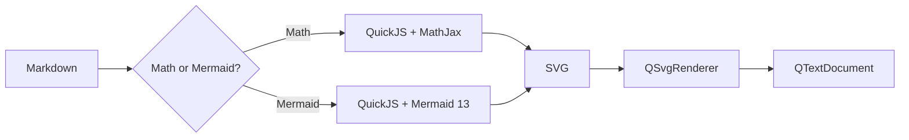

# rich-text-render spike

This window uses **Qt Widgets + QTextDocument** for Markdown, and renders math/mermaid blocks through QuickJS into SVG.

## Inline math

The quadratic formula is \(x = \frac{-b \pm \sqrt{b^2 - 4ac}}{2a}\), and inline symbols like \(\alpha, \beta, \gamma\) should work too.

## Display math

$$
\int_0^1 x^2 \, dx = \frac{1}{3}
$$

$$
\sum_{i=1}^{n} i = \frac{n(n+1)}{2}
$$

## Mermaid



## Markdown checks

| Feature | Status |
|---|---|
| Table | expected to work |
| Code block | expected to work |
| CJK | 中文混排、标点、emoji 🐟 |
| Long link | [Qt documentation](https://doc.qt.io/qt-6/) |

```cpp
int main() {
    return 0;
}
```
