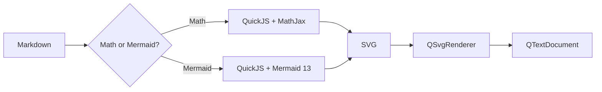

# rich-text-renderer

This window uses **Qt Widgets + QTextDocument** for Markdown, and renders math/mermaid blocks through QuickJS into SVG.

## Inline math

The quadratic formula is \(x = \frac{-b \pm \sqrt{b^2 - 4ac}}{2a}\), and inline symbols like \(\alpha, \beta, \gamma\) should work too.

Dollar delimiters: $a^2 + b^2 = c^2$ and escaped currency: \$5 and \$10.

## Display math

$$
\int_0^1 x^2 \, dx = \frac{1}{3}
$$

$$
\sum_{i=1}^{n} i = \frac{n(n+1)}{2}
$$

\[
\begin{aligned}
  (a+b)^2 &= a^2 + 2ab + b^2 \\
  (a-b)^2 &= a^2 - 2ab + b^2
\end{aligned}
\]

## Mermaid



## Code blocks

```cpp
// C++
int main() {
    const QString text = "hello";
    return text.size();
}
```

```python
# Python
def greet(name: str) -> str:
    return f"hello {name}"
```

```javascript
// JavaScript
const value = 42;
console.log(`value = ${value}`);
```

```json
{
  "name": "rich-text-renderer",
  "enabled": true,
  "count": 3
}
```

```bash
#!/usr/bin/env bash
for file in *.md; do
  echo "$file"
done
```

```latex
% LaTeX source, not rendered as math
\frac{1}{2} + \sqrt{x}
```

## Markdown checks

| Feature | Status |
|---|---|
| Table | expected to work |
| Code block | expected to work |
| CJK | 中文混排、标点、emoji 🐟 |
| Long link | [Qt documentation](https://doc.qt.io/qt-6/) |
