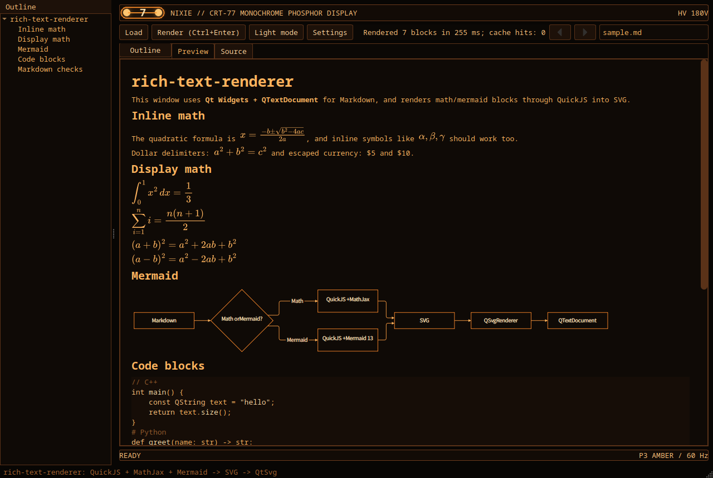
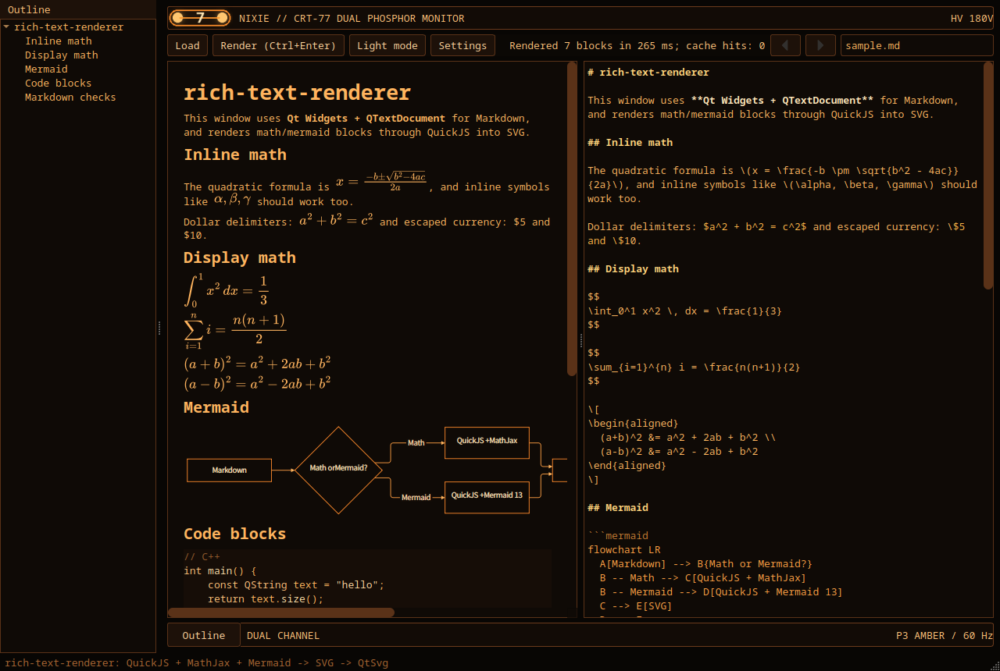

# Nixie CRT

`nixie-crt` is a warm-orange monochrome display theme inspired by Nixie tubes
and early CRT monitors. It uses a near-black brown background, a bright
fluorescent orange text color and a small glowing tube mark, while keeping the
document readable for long sessions.

The theme exercises the current user-theme schema: colors, typography, syntax
palettes, preview styling, Mermaid variables, a PNG asset, all slot style keys,
both content modes and metrics. Automatic responsive layout switching is not
implemented.

## Install

Copy the theme directory into the user theme location:

```bash
mkdir -p ~/.local/share/rich-text-renderer/rich-text-renderer/themes
cp -r samples/themes/nixie-crt \
  ~/.local/share/rich-text-renderer/rich-text-renderer/themes/
```

Then open **Settings → Appearance**, choose **Nixie CRT** and select one of the
two layout variants:

- **console**: tabbed Preview and Source. The header shows the tube mark, title
  and high-voltage label; the footer shows the signal state.
- **dual**: slots mode with Preview and Source side by side in a splitter. The
  Outline toggle is placed in the bottom slot.

The selected layout is stored as `appearance/layoutId` in the user settings.
If a layout cannot be loaded, the application falls back to the first variant
and then to the built-in default central layout.





## Palette

| Role | Color |
| --- | --- |
| Window / shell | `#080604` |
| Base surface | `#0f0a06` |
| Primary text | `#ffb45e` |
| Bright text | `#fff0d0` |
| Muted text | `#a86532` |
| Accent / highlight | `#ff8a2b` |
| Border | `#5a3218` |
| Code background | `#160d07` |

The accent is deliberately brighter than a real amber CRT so headings, links,
selection and diagram borders remain legible against the warm black surfaces.
`preview.maxTextWidth` is explicitly `0`: a fixed reading column would ignore
Preview pane or splitter expansion, which is not desirable for the dual layout.

## Capabilities used

- **Colors**: all user-theme color roles, including tooltips, placeholders,
  links, alternate rows and bevel borders.
- **Typography**: `Noto Sans Mono` for UI, Preview and code. Font sizes are
  still controlled by Settings.
- **Syntax palettes**: separate code and Source palettes, from bright headings
  to dim comments.
- **Preview**: width follows the pane or splitter, so expanding the Preview
  area makes the rendered document wider; the theme only sets the code
  background, code block spacing and a 20 px document margin.
- **Mermaid**: the `base` theme with all eight supported color variables, so
  diagrams use dark node fills and orange borders, lines and labels.
- **PNG asset**: `assets/nixie-mark.png` is a 96×34 transparent tube mark.
  It is displayed at natural size, centered and never stretched; larger content
  areas simply keep the natural size.
- **Slot styles**: all nine slot keys: top, bottom, empty, toolbar
  leading/trailing, content, Preview, Source and Outline.
- **`.ui` layouts**: `console.ui` uses `contentMode: tabs`; `dual.ui` uses
  `contentMode: slots` with a horizontal `QSplitter`.
- **Metrics**: compact spacing, a 3 px corner radius and a 20 px document
  margin.

## Files

```text
theme.json            Theme manifest: colors, typography, syntax, preview,
                      Mermaid, asset, slots, layout variants and metrics
console.ui            Tabbed console layout
dual.ui               Slot-based dual-pane layout
assets/nixie-mark.png Transparent Nixie tube mark with a soft glow
```

The layout files are static Qt Designer XML. The theme does not contain QSS,
QML, scripts or SVG resources.
